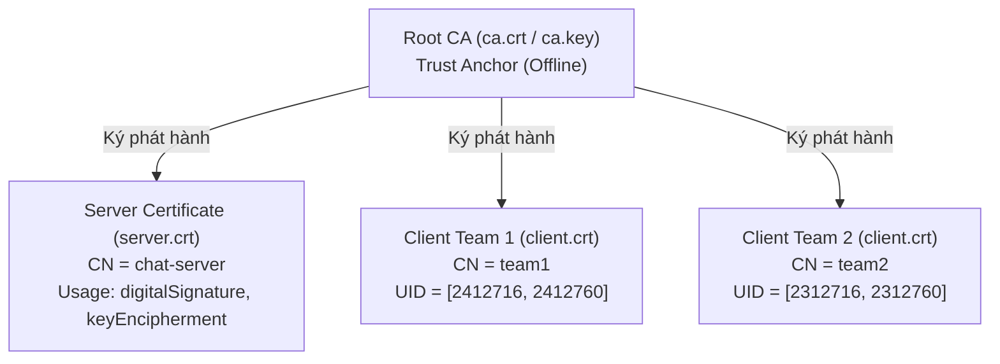
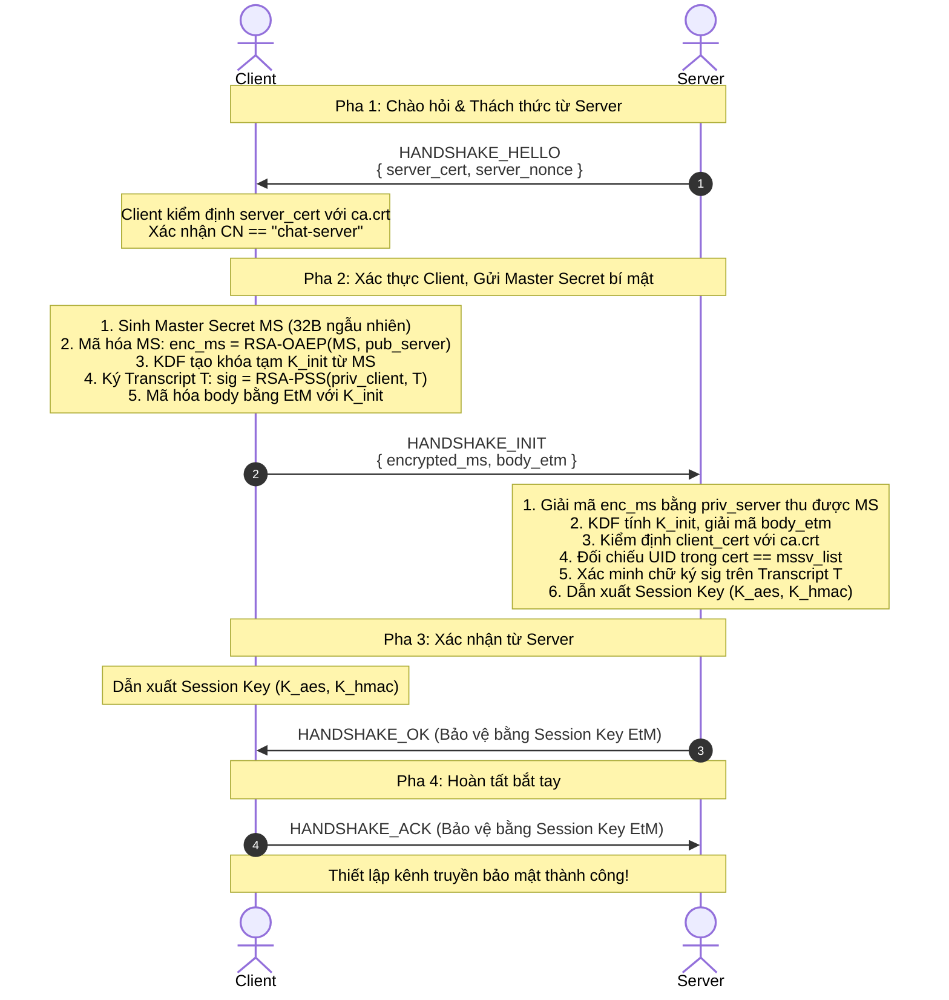
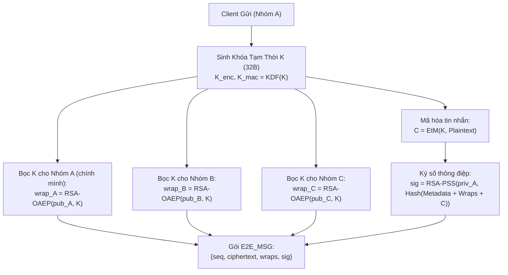

# BÁO CÁO KỸ THUẬT: HỆ THỐNG CHAT VÀ TRUYỀN FILE BẢO MẬT
## (SECURE CHAT & END-TO-END ENCRYPTED FILE TRANSFER)

---

**Môn học:** Mật mã và An ninh mạng  
**Đề tài:** Xây dựng ứng dụng Chat Client–Server và Truyền file bảo mật  
**Học kỳ:** HK261  
**Nhóm thực hiện:** Nhóm 01  

### Bảng phân công trách nhiệm thành viên

| STT | MSSV | Họ và tên | Vai trò / Nhiệm vụ chính | Tỷ lệ hoàn thành |
| :---: | :---: | :--- | :--- | :---: |
| 1 | 2412716 | Nguyễn Văn Phúc | Trưởng nhóm: Kiến trúc hệ thống, Giao thức Bắt tay, PKI & X.509, Kiểm thử MitM & Replay | 100% |
| 2 | 2412760 | Đỗ Hoàng Quốc Việt | Thành viên: Mã hóa đầu cuối (E2E Chat & File Transfer), Record Layer, Benchmarking | 100% |

**Giảng viên hướng dẫn:** TS. Nguyễn Văn A *(hoặc thông tin GVHD phụ trách)*  
**Thời gian thực hiện:** Tháng 10/2026  

---

## MỤC LỤC CHI TIẾT

- [MỤC LỤC CHI TIẾT](#mục-lục-chi-tiết)
- [DANH MỤC THUẬT NGỮ VÀ KÝ HIỆU KHOA HỌC](#danh-mục-thuật-ngữ-và-ký-hiệu-khoa-học)
- [CHƯƠNG 1 – GIỚI THIỆU](#chương-1--giới-thiệu)
  - [1.1. Bối cảnh và động cơ phát triển hệ thống](#11-bối-cảnh-và-động-cơ-phát-triển-hệ-thống)
  - [1.2. Các yêu cầu của hệ thống cần xây dựng](#12-các-yêu-cầu-của-hệ-thống-cần-xây-dựng)
    - [1.2.1. Yêu cầu chức năng (Functional Requirements)](#121-yêu-cầu-chức-năng-functional-requirements)
    - [1.2.2. Yêu cầu phi chức năng và an toàn thông tin (Security Requirements)](#122-yêu-cầu-phi-chức-năng-và-an-toàn-thông-tin-security-requirements)
  - [1.3. Phạm vi và giới hạn của hệ thống](#13-phạm-vi-và-giới-hạn-của-hệ-thống)
    - [1.3.1. Các hạng mục thuộc phạm vi hiện thực (In-Scope)](#131-các-hạng-mục-thuộc-phạm-vi-hiện-thực-in-scope)
    - [1.3.2. Các hạng mục ngoài phạm vi (Out-of-Scope)](#132-các-hạng-mục-ngoài-phạm-vi-out-of-scope)
  - [1.4. Cấu trúc nội dung của các chương tiếp theo](#14-cấu-trúc-nội-dung-của-các-chương-tiếp-theo)
- [CHƯƠNG 2 – PHÂN TÍCH VÀ THIẾT KẾ HỆ THỐNG](#chương-2--phân-tích-và-thiết-kế-hệ-thống)
  - [2.1. Cơ sở lý thuyết và các nguyên hàm mật mã cốt lõi](#21-cơ-sở-lý-thuyết-và-các-nguyên-hàm-mật-mã-cốt-lõi)
    - [2.1.1. Mã hóa đối xứng AES-256-CBC và cơ chế đệm PKCS#7](#211-mã-hóa-đối-xứng-aes-256-cbc-và-cơ-chế-đệm-pkcs7)
    - [2.1.2. Mã hóa bất đối xứng RSA-OAEP](#212-mã-hóa-bất-đối-xứng-rsa-oaep)
    - [2.1.3. Chữ ký số RSA-PSS](#213-chữ-ký-số-rsa-pss)
    - [2.1.4. Hàm băm mật mã và Hàm dẫn xuất khóa (KDF) dựa trên SHA-256](#214-hàm-băm-mật-mã-và-hàm-dẫn-xuất-khóa-kdf-dựa-trên-sha-256)
    - [2.1.5. Mô hình xác thực thông điệp Encrypt-then-MAC (EtM với HMAC-SHA256)](#215-mô-hình-xác-thực-thông-điệp-encrypt-then-mac-etm-với-hmac-sha256)
    - [2.1.6. Hạ tầng khóa công khai (PKI) và định dạng chứng chỉ X.509v3](#216-hạ-tầng-khóa-công-khai-pki-và-định-dạng-chứng-chỉ-x509v3)
  - [2.2. Phân tích mô hình đe dọa (Threat Modeling & Assumptions)](#22-phân-tích-mô-hình-đe-dọa-threat-modeling--assumptions)
    - [2.2.1. Phân loại tác nhân đe dọa và năng lực tấn công](#221-phân-loại-tác-nhân-đe-dọa-và-năng-lực-tấn-công)
    - [2.2.2. Các giả định an toàn căn bản (Security Assumptions)](#222-các-giả-định-an-toàn-căn-bản-security-assumptions)
  - [2.3. Thiết kế kiến trúc tổng thể hệ thống](#23-thiết-kế-kiến-trúc-tổng-thể-hệ-thống)
    - [2.3.1. Phân tầng kiến trúc logic (Layered Architecture)](#231-phân-tầng-kiến-trúc-logic-layered-architecture)
    - [2.3.2. Mô hình tin cậy (Trust Model) và phân cấp chứng chỉ](#232-mô-hình-tin-cậy-trust-model-và-phân-cấp-chứng-chỉ)
  - [2.4. Thiết kế giao thức tầng khung truyền và bản ghi (Framing & Record Layer)](#24-thiết-kế-giao-thức-tầng-khung-truyền-và-bản-ghi-framing--record-layer)
    - [2.4.1. Cấu trúc khung truyền TCP (Length-Prefixed Framing)](#241-cấu-trúc-khung-truyền-tcp-length-prefixed-framing)
    - [2.4.2. Cấu trúc gói tin Record Layer (EtM Packet Format)](#242-cấu-trúc-gói-tin-record-layer-etm-packet-format)
    - [2.4.3. Cơ chế kiểm soát số thứ tự (Seq) và Cửa sổ thời gian (Timestamp Window)](#243-cơ-chế-kiểm-soát-số-thứ-tự-seq-và-cửa-sổ-thời-gian-timestamp-window)
  - [2.5. Thiết kế giao thức bắt tay xác thực hai chiều (Mutual Handshake Protocol)](#25-thiết-kế-giao-thức-bắt-tay-xác-thực-hai-chiều-mutual-handshake-protocol)
    - [2.5.1. Quy trình giao thức bắt tay 4 bước](#251-quy-trình-giao-thức-bắt-tay-4-bước)
    - [2.5.2. Cấu trúc và thuật toán ký Transcript bắt tay (T)](#252-cấu-trúc-và-thuật-toán-ký-transcript-bắt-tay-t)
    - [2.5.3. Quy tắc mã hóa có độ dài tiền tố (Length-Prefixed Canonical Encoding)](#253-quy-tắc-mã-hóa-có-độ-dài-tiền-tố-length-prefixed-canonical-encoding)
    - [2.5.4. Dẫn xuất khóa phiên và bảo vệ tính bí mật của MSSV](#254-dẫn-xuất-khóa-phiên-và-bảo-vệ-tính-bí-mật-của-mssv)
  - [2.6. Thiết kế cơ chế mã hóa đầu cuối (End-to-End Encryption - E2E)](#26-thiết-kế-cơ-chế-mã-hóa-đầu-cuối-end-to-end-encryption---e2e)
    - [2.6.1. E2E Chat: Mô hình phân phối khóa đa người nhận (Multi-recipient RSA Key Wrapping)](#261-e2e-chat-mô-hình-phân-phối-khóa-đa-người-nhận-multi-recipient-rsa-key-wrapping)
    - [2.6.2. E2E File Transfer: Cơ chế chia mảnh (Chunking) và Chunk Order Binding](#262-e2e-file-transfer-cơ-chế-chia-mảnh-chunking-và-chunk-order-binding)
    - [2.6.3. Cơ chế lưu trữ bền vững trạng thái chống Replay (Persistent E2E Sequence State)](#263-cơ-chế-lưu-trữ-bền-vững-trạng-thái-chống-replay-persistent-e2e-sequence-state)
- [CHƯƠNG 3 – HIỆN THỰC VÀ ĐÁNH GIÁ HỆ THỐNG](#chương-3--hiện-thực-và-đánh-giá-hệ-thống)
  - [3.1. Hiện thực hệ thống](#31-hiện-thực-hệ-thống)
    - [3.1.1. Cấu trúc mã nguồn và tổ chức các module](#311-cấu-trúc-mã-nguồn-và-tổ-chức-các-module)
    - [3.1.2. Hiện thực tầng PKI và kiểm định chứng chỉ X.509 (`pki.py`)](#312-hiện-thực-tầng-pki-và-kiểm-định-chứng-chỉ-x509-pkipy)
    - [3.1.3. Hiện thực nguyên hàm mật mã và đóng khung truyền (`crypto_utils.py`, `framing.py`)](#313-hiện-thực-nguyên-hàm-mật-mã-và-đóng-khung-truyền-crypto_utilspy-framingpy)
    - [3.1.4. Hiện thực giao thức bắt tay hai chiều (`handshake.py`)](#314-hiện-thực-giao-thức-bắt-tay-hai-chiều-handshakepy)
    - [3.1.5. Hiện thực Record Layer và quản lý phiên an toàn (`session.py`)](#315-hiện-thực-record-layer-và-quản-lý-phiên-an-toàn-sessionpy)
    - [3.1.6. Hiện thực tầng mã hóa đầu cuối Chat và File (`e2e.py`)](#316-hiện-thực-tầng-mã-hóa-đầu-cuối-chat-và-file-e2epy)
    - [3.1.7. Hiện thực Server đa luồng và Client CLI tương tác (`server.py`, `client.py`)](#317-hiện-thực-server-đa-luồng-và-client-cli-tương-tác-serverpy-clientpy)
    - [3.1.8. Kỹ thuật giải quyết các lỗ hổng an ninh bổ sung (Security Hardening)](#318-kỹ-thuật-giải-quyết-các-lỗ-hổng-an-ninh-bổ-sung-security-hardening)
  - [3.2. Phương pháp và môi trường đánh giá](#32-phương-pháp-và-môi-trường-đánh-giá)
    - [3.2.1. Môi trường thực nghiệm](#321-môi-trường-thực-nghiệm)
    - [3.2.2. Chiến lược và phương pháp kiểm thử](#322-chiến-lược-và-phương-pháp-kiểm-thử)
  - [3.3. Kết quả đánh giá kiểm thử chức năng và an ninh](#33-kết-quả-đánh-giá-kiểm-thử-chức-năng-và-an-ninh)
    - [3.3.1. Tổng kết kết quả bộ 63 Test Cases tự động](#331-tổng-kết-kết-quả-bộ-63-test-cases-tự-động)
    - [3.3.2. Đánh giá thực nghiệm các kịch bản tấn công điển hình](#332-đánh-giá-thực-nghiệm-các-kịch-bản-tấn-công-điển-hình)
  - [3.4. Đánh giá hiệu năng hệ thống (Performance Benchmarking)](#34-đánh-giá-hiệu-năng-hệ-thống-performance-benchmarking)
    - [3.4.1. Thời gian thiết lập bắt tay (Handshake Latency)](#341-thời-gian-thiết-lập-bắt-tay-handshake-latency)
    - [3.4.2. Thông lượng và thời gian xử lý truyền file E2E](#342-thông-lượng-và-thời-gian-xử-lý-truyền-file-e2e)
    - [3.4.3. Phân tích độ phình dữ liệu giao thức (Protocol Overhead)](#343-phân-tích-độ-phình-dữ-liệu-giao-thức-protocol-overhead)
- [CHƯƠNG 4 – KẾT LUẬN](#chương-4--kết-luận)
  - [4.1. Những kết quả đã đạt được đối chiếu với yêu cầu](#41-những-kết-quả-đã-đạt-được-đối-chiếu-với-yêu-cầu)
  - [4.2. Những điểm chưa thực hiện được và hạn chế còn tồn đọng](#42-những-điểm-chưa-thực-hiện-được-và-hạn-chế-còn-tồn-đọng)
  - [4.3. Đánh giá ưu điểm và nhược điểm của hệ thống](#43-đánh-giá-ưu-điểm-và-nhược-điểm-của-hệ-thống)
    - [4.3.1. Ưu điểm nổi bật](#431-ưu-điểm-nổi-bật)
    - [4.3.2. Nhược điểm và hạn chế tồn tại](#432-nhược-điểm-và-hạn-chế-tồn-tại)
  - [4.4. Hướng nghiên cứu và phát triển trong tương lai](#44-hướng-nghiên-cứu-và-phát-triển-trong-tương-lai)
- [TÀI LIỆU THAM KHẢO](#tài-liệu-tham-khảo)
- [PHỤ LỤC](#phụ-lục)
  - [Phụ lục A: Danh mục chi tiết 63 Test Cases kiểm thử tự động](#phụ-lục-a-danh-mục-chi-tiết-63-test-cases-kiểm-thử-tự-động)
  - [Phụ lục B: Bảng thông số kỹ thuật môi trường và thư viện phần mềm](#phụ-lục-b-bảng-thông-số-kỹ-thuật-môi-trường-và-thư-viện-phần-mềm)
  - [Phụ lục C: Hướng dẫn chi tiết quy trình triển khai và kiểm thử](#phụ-lục-c-hướng-dẫn-chi-tiết-quy-trình-triển-khai-và-kiểm-thử)

---

## DANH MỤC THUẬT NGỮ VÀ KÝ HIỆU KHOA HỌC

| Thuật ngữ / Ký hiệu | Tên đầy đủ / Định nghĩa | Mô tả trong hệ thống |
| :--- | :--- | :--- |
| **AES** | Advanced Encryption Standard | Thuật toán mã hóa đối xứng khối (kích thước khối 128 bit, khóa 256 bit). |
| **CBC** | Cipher Block Chaining | Chế độ hoạt động của mật mã khối, kết hợp khối bản rõ với bản mã liền trước qua phép XOR. |
| **RSA** | Rivest–Shamir–Adleman | Thuật toán mật mã bất đối xứng (sử dụng độ dài khóa 2048 bit). |
| **OAEP** | Optimal Asymmetric Encryption Padding | Cơ chế đệm an toàn ngẫu nhiên hóa cho mã hóa RSA. |
| **PSS** | Probabilistic Signature Scheme | Cơ chế đệm ngẫu nhiên hóa đạt tính an toàn chứng minh được cho chữ ký số RSA. |
| **HMAC** | Hash-based Message Authentication Code | Mã xác thực thông điệp xây dựng trên nền tảng hàm băm SHA-256. |
| **EtM** | Encrypt-then-MAC | Mô hình kết hợp mật mã: mã hóa bản rõ trước, sau đó tính MAC trên bản mã và IV. |
| **E2E** | End-to-End Encryption | Mã hóa đầu cuối: dữ liệu chỉ được giải mã bởi các client nhận hợp lệ, máy chủ trung gian không thể đọc. |
| **PKI** | Public Key Infrastructure | Hạ tầng khóa công khai, quản lý phát hành và xác thực chứng chỉ số X.509. |
| **CA** | Certificate Authority | Cơ quan chứng thực gốc (Root CA) ký phát hành chứng chỉ cho server và các client. |
| **CN** | Common Name | Trường định danh chủ thể trong chứng chỉ (ví dụ: `chat-server`, `team1`). |
| **UID** | Unique Identifier | Thuộc tính đối tượng (OID `0.9.2342.19200300.100.1.1`) chứa danh sách MSSV thành viên. |
| **MS** | Master Secret | Chuỗi ngẫu nhiên 32 byte do client sinh trong bắt tay, bảo vệ bằng RSA-OAEP. |
| **KDF** | Key Derivation Function | Hàm dẫn xuất khóa nhằm phân tách khóa mã hóa và khóa xác thực an toàn. |
| **MitM** | Man-in-the-Middle | Tấn công kẻ đứng giữa, nghe lén, sửa đổi hoặc chèn dữ liệu vào đường truyền. |
| **IV** | Initialization Vector | Vector khởi tạo ngẫu nhiên 16 byte sử dụng trong chế độ mã hóa CBC. |
| $x \parallel y$ | Concatenation operator | Phép nối hai chuỗi byte $x$ và $y$. |
| $\text{enc}(x)$ | Canonical Length-prefixed Encoding | Hàm mã hóa có tiền tố độ dài 4 byte: $\text{len}(x)_{4\text{B}} \parallel x$. |

---

# CHƯƠNG 1 – GIỚI THIỆU

### 1.1. Bối cảnh và động cơ phát triển hệ thống

Trong kỷ nguyên chuyển đổi số và truyền thông phân tán, nhu cầu trao đổi thông tin trực tuyến, tin nhắn tức thời (Instant Messaging) và chia sẻ tệp dữ liệu qua mạng công cộng (Internet/Intranet) đã trở thành một tiện ích thiết yếu trong môi trường giáo dục, doanh nghiệp và các tổ chức chính phủ. Tuy nhiên, các giao thức truyền thông nguyên thủy (như socket TCP thuần túy, IRC, Telnet, FTP) truyền dữ liệu ở dạng văn bản rõ (plaintext). Trên một mạng truyền thông không tin cậy, kẻ tấn công nằm trên đường truyền (như tin tặc cùng mạng Wi-Fi công cộng, nhà cung cấp dịch vụ mạng không trung thực ISP, hoặc kẻ xâm nhập bộ định tuyến mạng) hoàn toàn có khả năng:
1. **Nghe lén dữ liệu (Eavesdropping):** Đọc trộm nội dung các đoạn hội thoại nhạy cảm, thông tin tài khoản, danh tính sinh viên và tệp tài liệu nội bộ.
2. **Tấn công kẻ đứng giữa (Man-in-the-Middle - MitM):** Chặn bắt kết nối, đóng giả máy chủ hoặc máy trạm, đánh tráo khóa công khai để âm thầm giải mã toàn bộ dữ liệu trung chuyển mà hai đầu cầu không hề hay biết.
3. **Tấn công phát lại (Replay Attacks):** Ghi lại các gói tin hợp lệ và gửi lại vào một thời điểm khác nhằm thao túng trạng thái phiên làm việc hoặc giả mạo lệnh gửi tin.
4. **Mạo danh người dùng (Impersonation / Spoofing):** Tự xưng là một thành viên hoặc một nhóm khác để phát tán thông tin sai lệch, xâm phạm tính toàn vẹn danh tính.
5. **Khai thác máy chủ trung gian (Compromised Server Threat):** Ngay cả khi kênh truyền giữa Client và Server được bảo vệ (ví dụ: dùng TLS thông thường kết thúc tại Server), bản thân máy chủ lưu trữ bản rõ của tin nhắn và tệp tin. Nếu máy chủ bị tấn công hoặc quản trị viên thiếu trung thực, toàn bộ quyền riêng tư của người dùng sẽ bị xâm phạm hoàn toàn.

Xuất phát từ các nguy cơ an ninh hiện hữu đó, đồ án **"Hệ thống Chat và Truyền file bảo mật (Secure Chat & E2E File Transfer)"** được thiết kế và hiện thực hóa nhằm xây dựng một giải pháp giao tiếp client–server toàn diện, tích hợp chặt chẽ các nguyên hàm mật mã hiện đại, đạt chuẩn an toàn cao nhất với mô hình **Mã hóa đầu cuối (End-to-End Encryption)** và **Xác thực định danh bằng Hạ tầng khóa công khai (PKI X.509)**.

### 1.2. Các yêu cầu của hệ thống cần xây dựng

Hệ thống được thiết kế nhằm đáp ứng đầy đủ cả hai nhóm yêu cầu: nghiệp vụ chức năng và an toàn bảo mật nghiêm ngặt.

#### 1.2.1. Yêu cầu chức năng (Functional Requirements)
- **RF-01 (Quản lý kết nối Client–Server đa luồng):** Máy chủ có khả năng phục vụ đồng thời nhiều máy trạm thuộc các nhóm sinh viên khác nhau qua giao thức hướng kết nối TCP Socket.
- **RF-02 (Cơ chế bắt tay và thương lượng khóa):** Trước khi bước vào giai đoạn truyền dữ liệu ứng dụng, Client và Server phải thực hiện giao thức bắt tay (handshake) để xác thực danh tính lẫn nhau và thiết lập khóa phiên bảo mật độc lập cho kênh truyền.
- **RF-03 (Quản lý Roster & Trạng thái người dùng):** Máy chủ duy trì danh sách các nhóm đang trực tuyến (Online Roster). Client có thể truy vấn danh sách này (`!roster`) kèm chứng chỉ số công khai của các bên liên quan.
- **RF-04 (Trò chuyện trực tuyến mã hóa đầu cuối - E2E Chat):** Client có khả năng soạn thảo và gửi tin nhắn văn bản đến phòng chat chung. Mọi thành viên trực tuyến đều nhận và giải mã được tin nhắn, trong khi máy chủ chỉ đóng vai trò chuyển tiếp (relay) bản mã mà không thể đọc được nội dung gốc.
- **RF-05 (Truyền tệp mã hóa đầu cuối - E2E File Transfer):** 
  - Client gửi tệp tin (`!sendfile <path>`) lên máy chủ. Tệp được mã hóa đầu cuối, chia nhỏ thành các mảnh (chunks), bảo vệ toàn vẹn và ký số.
  - Máy chủ lưu trữ tệp ở dạng mã hóa nguyên vẹn trong thư mục quản lý, không giải mã.
  - Các client khác có thể liệt kê danh sách tệp trên máy chủ (`!listfiles`) và tải tệp về (`!getfile <filename>`), tự động giải mã và kiểm tra mã băm SHA-256 toàn vẹn trước khi ghi đĩa.
- **RF-06 (Ngắt kết nối an toàn):** Người dùng có thể chủ động thoát ứng dụng (`exit`). Phiên làm việc được giải phóng tài nguyên an toàn ở cả hai phía.

#### 1.2.2. Yêu cầu phi chức năng và an toàn thông tin (Security Requirements)
- **RS-01 (Tính bí mật - Confidentiality):**
  - Tuyệt đối không để lộ dữ liệu bản rõ của tin nhắn chat và tệp tin trên đường truyền hoặc trong bộ nhớ/ổ đĩa của máy chủ.
  - Bảo vệ danh tính nhạy cảm (danh sách MSSV của nhóm) ngay trong pha bắt tay, không gửi văn bản rõ trên kênh truyền.
- **RS-02 (Tính xác thực và chống mạo danh - Authentication & Non-repudiation):**
  - Xác thực hai chiều (Mutual Authentication) bắt buộc: Client phải xác thực máy chủ hợp lệ và Máy chủ phải xác thực danh tính nhóm sinh viên trước khi chấp nhận phiên làm việc.
  - Định danh phải được neo vào chứng chỉ số X.509 ký bởi Root CA nội bộ đáng tin cậy. Máy chủ phải đối chiếu thuộc tính UID trong chứng chỉ với MSSV do client khai báo.
  - Chữ ký số bất đối xứng (RSA-PSS) được áp dụng trên bản ghi bắt tay (Handshake Transcript) và trên từng tin nhắn/tệp tin E2E nhằm chống chối bỏ trách nhiệm.
- **RS-03 (Tính toàn vẹn dữ liệu - Data Integrity):**
  - Áp dụng cấu trúc Encrypt-then-MAC (EtM) kết hợp AES-256-CBC và HMAC-SHA256. Bất kỳ sự thay đổi dù chỉ 1 bit trên đường truyền đều phải bị phát hiện và từ chối trước khi tiến hành giải mã (loại bỏ hoàn toàn lỗ hổng Padding Oracle).
  - Tệp dữ liệu truyền tải phải được ràng buộc mã băm SHA-256 của toàn bộ nội dung trong phần siêu dữ liệu (metadata) đã ký số.
- **RS-04 (Chống tấn công phát lại - Anti-Replay):**
  - Sử dụng số thứ tự gói tin (`seq`) tăng dần đơn điệu, được bao bọc bên trong trường bảo vệ của MAC.
  - Kết hợp cửa sổ thời gian (Timestamp Window) nhằm hạn chế tối đa nguy cơ các gói tin hợp lệ bị kẻ tấn công bắt giữ và phát lại.
  - Số thứ tự E2E phải được duy trì bền vững (Persistent State) qua các lần khởi động lại máy trạm.
- **RS-05 (Chống tấn công từ chối dịch vụ cơ bản - DoS & Resource Exhaustion Defense):**
  - Thiết lập ngưỡng trần kích thước khung truyền (`MAX_FRAME = 64 KiB`) và kích thước tệp tối đa (`MAX_FILE = 10 MiB`) nhằm chống cạn kiệt RAM máy chủ.
  - Cơ chế Heartbeat (`PING`/`PONG`) định kỳ và Socket Timeout tự động ngắt các kết nối treo (Zombie connections).
  - Khóa đồng bộ hóa (Thread Lock) tại tầng truyền thông nhằm triệt tiêu hiện tượng tương tranh (Race Condition) khi nhiều luồng cùng ghi socket.

### 1.3. Phạm vi và giới hạn của hệ thống

#### 1.3.1. Các hạng mục thuộc phạm vi hiện thực (In-Scope)
1. Xây dựng bộ công cụ quản lý hạ tầng khóa công khai nội bộ (`tools/make_pki.py`): Khởi tạo Root CA tự ký, cấp phát chứng chỉ số X.509 cho máy chủ (`CN=chat-server`) và chứng chỉ định danh cho từng nhóm sinh viên (`CN=teamX`, `UID=MSSV`).
2. Giao thức khung truyền nhị phân (Length-prefixed framing) trên nền TCP.
3. Giao thức bắt tay bảo mật xác thực hai chiều, trao đổi Master Secret mã hóa bằng RSA-OAEP, bảo vệ transcript bằng chữ ký số RSA-PSS và mã hóa gói tin bắt tay `HANDSHAKE_INIT`.
4. Hàm dẫn xuất khóa (KDF) chuẩn hóa, giải quyết triệt để lỗi nhập nhằng ghép chuỗi (Canonical Length-prefixed Encoding).
5. Tầng phiên bảo vệ kênh truyền (Record Layer) theo mô hình Encrypt-then-MAC (AES-256-CBC + HMAC-SHA256).
6. Tầng ứng dụng mã hóa đầu cuối (E2E): Mã hóa tin nhắn chat cho nhiều người nhận bằng kỹ thuật bọc khóa RSA-OAEP (RSA Key Wrapping); truyền tệp phân mảnh (Chunking 4 KiB), đóng dấu thứ tự phân mảnh trong MAC và kiểm tra toàn vẹn băm SHA-256.
7. Cơ chế lưu trữ bền vững số thứ tự (`seq`) ra tệp cục bộ có kiểm tra tính nguyên tử (Atomic write).
8. Các cơ chế phòng vệ chống Path Traversal khi nhận tệp, dọn dẹp tệp rác khi truyền lỗi, và lọc mã điều khiển ANSI độc hại.
9. Xây dựng bộ kiểm thử tự động toàn diện (63 Unit Tests & Integration Tests) bao phủ 100% các yêu cầu an ninh và kịch bản tấn công.

#### 1.3.2. Các hạng mục ngoài phạm vi (Out-of-Scope)
Nhằm tập trung tối đa vào độ sâu mật mã và tính ổn định cốt lõi của giao thức theo yêu cầu đồ án, các tính năng sau được ghi nhận nằm ngoài phạm vi hiện thực:
- **Tính bí mật chuyển tiếp hoàn hảo (Perfect Forward Secrecy - PFS):** Hệ thống sử dụng khóa RSA dài hạn của Server để bọc Master Secret trong bắt tay (chưa áp dụng trao đổi khóa tạm thời ECDHE Ephemeral).
- **Phân tách khóa hai chiều chống Reflection:** Kênh truyền Client–Server hiện dùng chung cặp khóa phiên cho cả chiều gửi và nhận (sẽ được khắc phục bằng HKDF đa nhãn trong hướng phát triển).
- **Cơ chế thu hồi chứng chỉ trực tuyến (CRL / OCSP):** Giả định chứng chỉ hợp lệ trong suốt thời gian diễn ra đồ án.
- **Mã hóa bảo vệ khóa riêng tư tại máy trạm:** Các tệp khóa riêng tư `client.key` và `server.key` được lưu dưới dạng file PEM không cài mật khẩu passphrase.
- **Giao diện đồ họa người dùng (GUI):** Hệ thống giao tiếp qua giao diện dòng lệnh (CLI).

### 1.4. Cấu trúc nội dung của các chương tiếp theo

Báo cáo kỹ thuật được bố cục thành 4 chương chính và các phần bổ trợ theo chuẩn mực học thuật:
- **Chương 2 – Phân tích và thiết kế hệ thống:** Trình bày chi tiết cơ sở lý thuyết mật mã học, phân tích mô hình đe dọa, thiết kế kiến trúc phân tầng, đặc tả chi tiết giao thức khung truyền, giao thức bắt tay hai chiều, cơ chế dẫn xuất khóa chống nhập nhằng, và kiến trúc mã hóa đầu cuối E2E cho tin nhắn và truyền file.
- **Chương 3 – Hiện thực và đánh giá hệ thống:** Minh họa chi tiết việc lập trình hiện thực các module mã nguồn trọng yếu, các giải pháp kỹ thuật giải quyết bài toán hóc búa (race condition, socket blocking, persistent replay protection, path traversal); trình bày phương pháp thực nghiệm, kết quả 63 test cases tự động, phân tích thực nghiệm các kịch bản tấn công MitM, Replay, Tampering, và đo lường hiệu năng hệ thống.
- **Chương 4 – Kết luận:** Tổng kết các mục tiêu đã hoàn thành và chưa hoàn thành, đánh giá khách quan ưu điểm và nhược điểm kiến trúc, đồng thời đề xuất lộ trình nâng cấp hệ thống trong tương lai.
- **Tài liệu tham khảo & Phụ lục:** Cung cấp danh mục tài liệu tiêu chuẩn quốc tế (NIST, RFC) và bảng chi tiết 63 ca kiểm thử, hướng dẫn cấu hình môi trường và vận hành thực tế.

---

# CHƯƠNG 2 – PHÂN TÍCH VÀ THIẾT KẾ HỆ THỐNG

### 2.1. Cơ sở lý thuyết và các nguyên hàm mật mã cốt lõi

Việc lựa chọn các nguyên hàm mật mã đóng vai trò quyết định đến tính an toàn tổng thể của hệ thống. Nhóm nghiên cứu tuân thủ nghiêm ngặt nguyên tắc: *"Không tự phát minh thuật toán mật mã"* (Don't roll your own crypto) và *"Luôn sử dụng cấu hình mật mã đã được chuẩn hóa bởi NIST và RFC"*.

#### 2.1.1. Mã hóa đối xứng AES-256-CBC và cơ chế đệm PKCS#7
- **Thuật toán AES-256:** Chuẩn mã hóa tiên tiến (Advanced Encryption Standard - FIPS 197) hoạt động trên kích thước khối cố định 128 bit (16 byte) với kích thước khóa 256 bit (32 byte), cung cấp biên độ an toàn cực cao trước các nguy cơ tấn công vét cạn (brute-force) kể cả trong kỷ nguyên điện toán lượng tử (thuật toán Grover chỉ giảm không gian tìm kiếm xuống $2^{128}$).
- **Chế độ Cipher Block Chaining (CBC):** CBC liên kết các khối dữ liệu bằng cách thực hiện phép XOR giữa khối bản rõ hiện tại với khối bản mã trước đó trước khi đưa vào thuật toán mã hóa:
  $$C_0 = \text{AES}_K(P_0 \oplus IV)$$
  $$C_i = \text{AES}_K(P_i \oplus C_{i-1}) \quad (\forall i \ge 1)$$
  Trong đó, Vector khởi tạo ($IV$) có độ dài bắt buộc 16 byte, phải được tạo ngẫu nhiên bảo mật (CSPRNG via `os.urandom`) cho mỗi gói tin duy nhất. Việc tái sử dụng $IV$ trên cùng một khóa sẽ làm lộ thông tin tương quan giữa các khối bản rõ đầu tiên.
- **Cơ chế đệm PKCS#7 (RFC 5652):** Do dữ liệu truyền tải có kích thước bất kỳ, bản rõ phải được đệm để kích thước chia hết cho 16 byte. Nếu thiếu $k$ byte ($1 \le k \le 16$), giá trị byte $k$ sẽ được lặp lại đúng $k$ lần ở cuối chuỗi. Ngay cả khi bản rõ đã chia hết cho 16 byte, một khối đệm đầy đủ gồm 16 byte có giá trị `0x10` vẫn được bổ sung để đảm bảo tính tất định khi giải đệm.

#### 2.1.2. Mã hóa bất đối xứng RSA-OAEP
- **Thuật toán RSA (RFC 8017):** Hoạt động dựa trên độ khó của bài toán phân tích một hợp số lớn thành tích của hai số nguyên tố bí mật. Hệ thống sử dụng chiều dài khóa tiêu chuẩn 2048 bit, với số mũ công khai $e = 65537$.
- **Cơ chế đệm OAEP (Optimal Asymmetric Encryption Padding):** Tuyệt đối không sử dụng cơ chế đệm cũ PKCS#1 v1.5 do tồn tại lỗ hổng kinh điển Bleichenbacher Padding Oracle Attack. RSA-OAEP kết hợp hai hàm che mặt nạ ngẫu nhiên (Mask Generation Function - MGF1 sử dụng SHA-256) cùng chuỗi ngẫu nhiên sinh ra mỗi lần mã hóa (Seed). Điều này mang lại tính chất an toàn ngữ nghĩa (Semantic Security - IND-CCA2): cùng một bản rõ mã hóa nhiều lần sẽ cho ra các bản mã hoàn toàn khác nhau, ngăn chặn triệt để tấn công chọn bản rõ (CPA) và chọn bản mã (CCA).

#### 2.1.3. Chữ ký số RSA-PSS
- **Cơ chế đệm PSS (Probabilistic Signature Scheme):** Thay vì sử dụng cơ chế ký số tất định PKCS#1 v1.5, hệ thống áp dụng RSA-PSS kết hợp với hàm băm SHA-256 và MGF1. PSS bổ sung một giá trị muối ngẫu nhiên (salt) vào quá trình tạo chữ ký, tạo ra tính chất xác suất (chữ ký của cùng một dữ liệu tại hai thời điểm là khác nhau). PSS sở hữu chứng minh bảo mật chặt chẽ trong mô hình Random Oracle Model, đảm bảo tính không thể làm giả chữ ký ngay cả khi kẻ tấn công có quyền yêu cầu chữ ký trên các thông điệp tự chọn (EUF-CMA).

#### 2.1.4. Hàm băm mật mã và Hàm dẫn xuất khóa (KDF) dựa trên SHA-256
- **Hàm băm SHA-256 (FIPS PUB 180-4):** Tạo ra giá trị băm cố định 256 bit (32 byte) từ dữ liệu đầu vào có độ dài tùy ý. SHA-256 thỏa mãn ba tính chất an toàn cốt lõi: kháng tiền ảnh (pre-image resistance), kháng tiền ảnh thứ hai (second pre-image resistance) và kháng va chạm (collision resistance).
- **Hàm dẫn xuất khóa (Key Derivation Function):** Một nguyên tắc an ninh tối thượng là **"Không bao giờ sử dụng cùng một khóa bí mật cho hai mục đích mật mã khác nhau"** (vi phạm nguyên tắc tách biệt ngữ cảnh). Từ khóa phiên gốc $K_{\text{session}}$, hệ thống áp dụng SHA-256 kết hợp nhãn ngữ cảnh để phân tách thành hai khóa độc lập:
  $$K_{\text{aes}} = \text{SHA-256}(K_{\text{session}} \parallel \text{b"encryption"})$$
  $$K_{\text{hmac}} = \text{SHA-256}(K_{\text{session}} \parallel \text{b"authentication"})$$

#### 2.1.5. Mô hình xác thực thông điệp Encrypt-then-MAC (EtM với HMAC-SHA256)
Trong lý thuyết mật mã học có ba mô hình kết hợp giữa Mã hóa đối xứng và Mã xác thực thông điệp:
1. **Encrypt-and-MAC (E&M):** Tính MAC trên bản rõ, gửi kèm bản mã: $C = \text{Enc}(P)$, $T = \text{MAC}(P)$. Nhược điểm: $T$ có thể làm lộ thông tin về bản rõ $P$ (từng được dùng trong giao thức SSH).
2. **MAC-then-Encrypt (MtE):** Tính MAC trên bản rõ rồi mã hóa cả hai: $C = \text{Enc}(P \parallel \text{MAC}(P))$. Nhược điểm: Khi nhận, bên nhận phải giải mã trước rồi mới kiểm tra MAC. Điều này tạo điều kiện cho kẻ tấn công thực hiện tấn công Padding Oracle (như lỗ hổng POODLE trên TLS 1.0 - RFC 5246).
3. **Encrypt-then-MAC (EtM):** Mã hóa bản rõ trước, sau đó tính MAC trên Vector khởi tạo và toàn bộ bản mã:
   $$C = \text{AES-CBC}_{K_{\text{aes}}}(IV, \text{PKCS7}(P))$$
   $$T = \text{HMAC-SHA256}_{K_{\text{hmac}}}(IV \parallel C)$$
   Gói tin gửi đi: $\text{Frame} = IV \parallel C \parallel T$.

```
                       BẢN RÕ (Plaintext JSON)
                                 │
                                 ▼
                     ┌───────────────────────┐
                     │     Đệm PKCS#7        │
                     └───────────────────────┘
                                 │
                                 ▼
   IV (16B) ───────▶ ┌───────────────────────┐
   K_aes    ───────▶ │   AES-256-CBC Enc     │
                     └───────────────────────┘
                                 │
                                 ▼
                        BẢN MÃ C (Ciphertext)
                                 │
                 ┌───────────────┴───────────────┐
                 │                               │
                 ▼                               ▼
    ┌─────────────────────────┐      ┌───────────────────────┐
    │  IV (16B) ∥ C (N*16B)   │ ───▶ │ HMAC-SHA256(K_hmac)   │
    └─────────────────────────┘      └───────────────────────┘
                 │                               │
                 │                               ▼
                 │                          MAC Tag T (32B)
                 │                               │
                 └───────────────┬───────────────┘
                                 ▼
                GÓI TIN TRUYỀN: [ IV ∥ C ∥ T ]
```

*Lý do chọn EtM:* Nghiên cứu của Bellare và Namprempre (2000) đã chứng minh toán học rằng Encrypt-then-MAC là cơ chế duy nhất đảm bảo tính an toàn trước tấn công bản mã chọn ngẫu nhiên (IND-CCA2) trong mọi tình huống. Khi nhận dữ liệu, hệ thống **kiểm tra tính toàn vẹn của thẻ MAC trước bằng hàm so sánh thời gian thực `hmac.compare_digest`**. Nếu MAC không hợp lệ, gói tin bị hủy ngay lập tức mà không bao giờ chuyển sang bộ giải mã AES, triệt tiêu 100% nguy cơ rò rỉ kênh phụ Padding Oracle.

#### 2.1.6. Hạ tầng khóa công khai (PKI) và định dạng chứng chỉ X.509v3
Hệ thống sử dụng mô hình PKI phân cấp quản lý tập trung:
- Một **Root CA (Certificate Authority)** duy nhất đóng vai trò là điểm neo tin cậy (Trust Anchor), lưu trữ chứng chỉ tự ký `ca.crt` và giữ bí mật khóa riêng `ca.key`.
- Tất cả các thực thể (Server và các Client nhóm) đều phải đăng ký và sở hữu chứng chỉ số định dạng X.509 phiên bản 3 do Root CA này trực tiếp ký phát hành.
- **Cấu trúc trường định danh (Subject Distinguished Name):**
  - Chứng chỉ Server: Thuộc tính `CommonName (CN) = "chat-server"`.
  - Chứng chỉ Client: Thuộc tính `CommonName (CN) = "<tên nhóm>"` (ví dụ: `team1`), đồng thời danh sách mã số sinh viên của nhóm được gắn chặt vào các thuộc tính đối tượng `UID` (OID: `0.9.2342.19200300.100.1.1`).
  - Phần mở rộng kiểm soát quyền hạn (Extensions): Khóa leaf bắt buộc phải có thuộc tính `BasicConstraints(ca=False)` để ngăn chặn việc client dùng chứng chỉ của mình đóng giả làm CA cấp chứng chỉ con; phần mở rộng `KeyUsage` bắt buộc phải có cờ `digitalSignature` (và `keyEncipherment` đối với server).

---

### 2.2. Phân tích mô hình đe dọa (Threat Modeling & Assumptions)

Để thiết kế một hệ thống phòng thủ vững chắc, mô hình đe dọa được xây dựng dựa trên mô hình đối thủ Dolev-Yao kinh điển.

#### 2.2.1. Phân loại tác nhân đe dọa và năng lực tấn công

```
                   MÔ HÌNH TÁC NHÂN ĐE DỌA (DOLEV-YAO)
  
   [ Client A ] ══════════════════════════════════════════ [ Server ]
                     ▲                              ▲
                     │                              │
        ┌────────────┴──────────────────────────────┴───────────┐
        │                 KẺ TẤN CÔNG ĐƯỜNG TRUYỀN              │
        │  • Nghe lén (Eavesdropping)                           │
        │  • Bắt giữ và phát lại (Replay packet)                │
        │  • Sửa đổi dữ liệu (Tampering 1-bit / bit-flipping)   │
        │  • Kẻ đứng giữa (MitM - Tráo khóa công khai)          │
        │  • Bơm khung truyền rác, DoS tràn RAM                │
        └───────────────────────────────────────────────────────┘
```

| Tác nhân đe dọa | Năng lực & Vị trí | Mục tiêu tấn công | Biện pháp kỹ thuật ngăn chặn |
| :--- | :--- | :--- | :--- |
| **Kẻ nghe lén thụ động (Passive Eavesdropper)** | Nằm trên đường truyền mạng, bắt toàn bộ gói tin TCP đi qua. | Đọc nội dung tin nhắn, đánh cắp tệp tin, trích xuất MSSV sinh viên. | Mã hóa E2E toàn bộ tin nhắn & file; mã hóa gói `HANDSHAKE_INIT` che giấu MSSV; mã hóa kênh truyền EtM. |
| **Kẻ đứng giữa chủ động (Active MitM)** | Có khả năng sửa, xóa, chèn gói tin, giả mạo phản hồi DNS/ARP để chuyển hướng kết nối. | Đóng giả Server đối với Client và đóng giả Client đối với Server; đánh tráo khóa công khai. | Xác thực hai chiều bằng chứng chỉ X.509 ký bởi Root CA; ký số RSA-PSS trên toàn bộ Transcript bắt tay ($T$). |
| **Kẻ tấn công phát lại (Replay Attacker)** | Bắt các gói tin hợp lệ trên đường truyền và gửi lại vào thời điểm sau. | Đăng nhập lặp lại, tái kích hoạt lệnh gửi tin, gây mất đồng bộ phiên. | Số thứ tự `seq` tăng dần nghiêm ngặt được bảo vệ trong MAC; cửa sổ thời gian Timestamp $\pm 30$s; nonce ngẫu nhiên của Server trong bắt tay. |
| **Kẻ mạo danh (Spoofer / Impersonator)** | Thành viên một nhóm hoặc người ngoài muốn đóng giả nhóm khác. | Gửi tin nhắn nặc danh mang danh nghĩa nhóm nạn nhân; tải tệp độc hại. | Máy chủ kiểm tra `UID` trong chứng chỉ client khớp với danh sách MSSV khai báo; trường `sender` do Server tự trích xuất từ chứng chỉ; chữ ký E2E được xác thực chéo từ Roster. |
| **Kẻ tấn công toàn vẹn (Tampering Attacker)** | Thay đổi ngẫu nhiên các bit trên đường truyền. | Thao túng số liệu, phá vỡ logic ứng dụng, kích hoạt lỗi phần mềm. | Thẻ xác thực HMAC-SHA256 trên toàn bộ gói tin; băm SHA-256 ký số trên metadata tệp tin. |
| **Máy chủ bị xâm phạm (Compromised Server)** | Nắm toàn quyền kiểm soát máy chủ trung gian, đọc toàn bộ RAM và đĩa cứng của server. | Đọc trộm tin nhắn nội bộ của các nhóm, can thiệp nội dung tệp tin. | Mô hình E2E: Server không có khóa giải mã $K$; tệp lưu trữ dưới dạng bản mã phân mảnh; chữ ký số trên metadata ngăn server sửa nội dung tệp. |
| **Kẻ tấn công từ chối dịch vụ (DoS Attacker)** | Gửi gói tin có tiêu đề độ dài giả mạo cực lớn, giữ kết nối treo không truyền dữ liệu. | Làm cạn kiệt bộ nhớ máy chủ, treo tài nguyên socket. | Giới hạn `MAX_FRAME = 64 KiB`, `MAX_FILE = 10 MiB`; cơ chế Heartbeat PING/PONG và Socket Timeout 60 giây. |

#### 2.2.2. Các giả định an toàn căn bản (Security Assumptions)
1. **Khóa riêng của Root CA (`ca.key`) được bảo vệ tuyệt đối:** CA được vận hành ngoại tuyến (offline) trên máy trạm của quản trị viên hệ thống. Kẻ tấn công không thể chiếm đoạt được `ca.key`.
2. **Hệ điều hành của các Client không bị can thiệp sâu (Clean Endpoint):** Khóa riêng của Client không bị phần mềm độc hại (trojan/keylogger) đánh cắp trực tiếp từ bộ nhớ RAM trong lúc ứng dụng đang chạy.
3. **Các nguyên hàm mật mã chuẩn (AES, RSA, SHA-256, HMAC) an toàn về mặt toán học:** Không tồn tại lỗ hổng thuật toán cho phép phá mã mà không cần vét cạn khóa.

---

### 2.3. Thiết kế kiến trúc tổng thể hệ thống

#### 2.3.1. Phân tầng kiến trúc logic (Layered Architecture)

Hệ thống được thiết kế theo mô hình kiến trúc phân lớp hướng module (Modular Layered Architecture). Mỗi tầng đảm nhiệm một trách nhiệm độc lập và chỉ giao tiếp với tầng liền kề thông qua giao diện hàm rõ ràng.

```
+-----------------------------------------------------------------------+
| 7. Application Layer: client.py (CLI interface), server.py (Relay/Store)|
+-----------------------------------------------------------------------+
| 6. End-to-End Layer (e2e.py): E2E Chat, E2E File Transfer, RSA Wrap   |
+-----------------------------------------------------------------------+
| 5. Record Layer (session.py): Encrypt-then-MAC, Seq, Timestamp, Lock  |
+-----------------------------------------------------------------------+
| 4. Handshake Layer (handshake.py): Mutual Auth, Transcript, KDF       |
+-----------------------------------------------------------------------+
| 3. Cryptographic Primitives (crypto_utils.py): AES, RSA, HMAC, SHA    |
+-----------------------------------------------------------------------+
| 2. Public Key Infrastructure (pki.py): X.509 Verification, CA trust   |
+-----------------------------------------------------------------------+
| 1. Framing Layer (framing.py): 4-byte Length-Prefix, MAX_FRAME guard  |
+-----------------------------------------------------------------------+
| 0. Transport Layer: OS TCP Sockets (IPv4/IPv6 stream)                 |
+-----------------------------------------------------------------------+
```

#### 2.3.2. Mô hình tin cậy (Trust Model) và phân cấp chứng chỉ

Cơ chế phân cấp xác thực số đảm bảo nguyên tắc: **Bất kỳ thực thể nào tham gia mạng lưới đều phải có danh tính được bảo chứng bởi Root CA.**



- **Quy tắc thẩm định phía Client:** Khi kết nối, Client chỉ chấp nhận máy chủ có chứng chỉ do `ca.crt` ký và thuộc tính `CN` phải khớp chính xác với chuỗi định danh `"chat-server"`.
- **Quy tắc thẩm định phía Server:** Khi nhận kết nối, Server yêu cầu Client xuất trình chứng chỉ số. Server kiểm tra chữ ký của CA, kiểm tra tính hợp lệ về thời gian, và đặc biệt **trích xuất danh sách thuộc tính `UID` trong chứng chỉ để so khớp với danh sách MSSV do Client khai báo trong gói bắt tay**. Nếu có bất kỳ sự sai lệch nào, Server lập tức ngắt kết nối.

---

### 2.4. Thiết kế giao thức tầng khung truyền và bản ghi (Framing & Record Layer)

Do giao thức TCP là giao thức hướng luồng byte (Byte-stream protocol) không bảo toàn ranh giới thông điệp (hiện tượng dính gói - packet coalescing hoặc vỡ gói - packet fragmentation), hệ thống thiết kế tầng khung truyền (Framing Layer) và tầng bản ghi (Record Layer) để chuẩn hóa định dạng giao tiếp.

#### 2.4.1. Cấu trúc khung truyền TCP (Length-Prefixed Framing)
Mọi gói tin truyền qua socket đều được tiền tố hóa bằng một trường độ dài 4 byte theo định dạng Big-Endian:
```
 0                   1                   2                   3
 0 1 2 3 4 5 6 7 8 9 0 1 2 3 4 5 6 7 8 9 0 1 2 3 4 5 6 7 8 9 0 1
+-+-+-+-+-+-+-+-+-+-+-+-+-+-+-+-+-+-+-+-+-+-+-+-+-+-+-+-+-+-+-+-+
|                      Payload Length (4 bytes)                 |
+-+-+-+-+-+-+-+-+-+-+-+-+-+-+-+-+-+-+-+-+-+-+-+-+-+-+-+-+-+-+-+-+
|                                                               |
|                   Payload Data (Variable Length)              |
|                                                               |
+-+-+-+-+-+-+-+-+-+-+-+-+-+-+-+-+-+-+-+-+-+-+-+-+-+-+-+-+-+-+-+-+
```
- Ngưỡng giới hạn kích thước an toàn: $\text{Payload Length} \le \text{MAX\_FRAME} = 65,536 \text{ byte (64 KiB)}$.
- Nếu bên nhận đọc được trường độ dài lớn hơn 64 KiB, kết nối lập tức bị đóng ngay mà không đọc tiếp payload nhằm triệt tiêu nguy cơ tấn công DoS tràn bộ nhớ đệm (Buffer Overflow / Memory Exhaustion).

#### 2.4.2. Cấu trúc gói tin Record Layer (EtM Packet Format)
Sau khi hoàn tất bắt tay, toàn bộ dữ liệu trao đổi được đóng gói dưới dạng bản ghi mã hóa đối xứng Encrypt-then-MAC:
```
+----------------+-----------------------------------+--------------------+
|    IV (16B)    | Ciphertext C (N*16B, AES-256-CBC) | MAC Tag T (32B)    |
+----------------+-----------------------------------+--------------------+
```
Trong đó:
- $IV$: 16 byte ngẫu nhiên tạo bởi `os.urandom(16)`.
- Bản rõ trước khi mã hóa là chuỗi JSON mã hóa UTF-8 chứa đầy đủ siêu dữ liệu quản lý phiên:
  ```json
  {
    "type": "<LOẠI_GÓI_TIN>",
    "sender": "<TÊN_NGƯỜI_GỬI>",
    "seq": 105,
    "timestamp": 1729845600.125,
    "payload": { ... }
  }
  ```
- $C = \text{AES-256-CBC}_{K_{\text{aes}}}(IV, \text{PKCS7}(\text{Plaintext JSON}))$.
- $T = \text{HMAC-SHA256}_{K_{\text{hmac}}}(IV \parallel C)$.

#### 2.4.3. Cơ chế kiểm soát số thứ tự (Seq) và Cửa sổ thời gian (Timestamp Window)
Để đối phó toàn diện với tấn công phát lại (Replay Attacks), Record Layer áp dụng cơ chế phòng vệ 2 lớp:
1. **Lớp 1 - Số thứ tự tuần tự tăng dần (`seq`):**
   - Mỗi chiều truyền thông duy trì một bộ đếm số nguyên riêng biệt, bắt đầu từ $1$ và tăng thêm $1$ cho mỗi gói gửi đi.
   - Bên nhận duy trì biến trạng thái `expected_seq`. Khi nhận một gói tin, sau khi xác thực HMAC thành công, bên nhận kiểm tra điều kiện nghiêm ngặt:
     $$\text{seq}_{\text{received}} == \text{expected\_seq}$$
   - Nếu $\text{seq}_{\text{received}} \ne \text{expected\_seq}$ (bị lặp lại, bị lùi lại hoặc bị nhảy cóc do mất gói/chèn gói), bên nhận từ chối gói tin và chủ động đóng kết nối ngay lập tức.
2. **Lớp 2 - Cửa sổ kiểm định thời gian (Timestamp Window):**
   - Mỗi gói tin ghi nhận dấu thời gian tại thời điểm tạo `timestamp` (độ chính xác microsecond).
   - Bên nhận so sánh với đồng hồ hệ thống hiện tại ($t_{\text{now}}$):
     $$t_{\text{now}} - 30.0 \le \text{timestamp} \le t_{\text{now}} + 10.0$$
   - Gói tin có thời gian nằm ngoài cửa sổ (quá cũ trên 30 giây hoặc sai lệch tương lai trên 10 giây) sẽ bị loại bỏ. Cửa sổ này đóng vai trò chặn đứng các gói tin phát lại xuyên phiên hoặc các gói tin bị kẻ tấn công giữ lại trong hàng đợi quá lâu.

---

### 2.5. Thiết kế giao thức bắt tay xác thực hai chiều (Mutual Handshake Protocol)

Giao thức bắt tay là trung tâm bảo mật của toàn bộ hệ thống, thiết lập sự tin cậy lẫn nhau giữa Client và Server mà không làm rò rỉ bất kỳ thông tin nhạy cảm nào ra kênh truyền.

#### 2.5.1. Quy trình giao thức bắt tay 4 bước



- **Bước 1 (`HANDSHAKE_HELLO`):** Server chủ động gửi chứng chỉ số của mình (`server_cert` định dạng PEM) kèm một số ngẫu nhiên thách thức `server_nonce` (32 byte ngẫu nhiên). Client kiểm tra chứng chỉ máy chủ bằng `ca.crt`. Nếu máy chủ không có chứng chỉ hợp lệ hoặc `CN` khác `"chat-server"`, Client lập tức ngắt kết nối.
- **Bước 2 (`HANDSHAKE_INIT`):** 
  - Client sinh chuỗi ngẫu nhiên Master Secret ($MS$) 32 byte.
  - Client mã hóa bất đối xứng $MS$ bằng khóa công khai của máy chủ trích xuất từ `server_cert`: $\text{encrypted\_ms} = \text{RSA-OAEP}(\text{pub\_server}, MS)$.
  - Client dẫn xuất cặp khóa tạm thời phục vụ mã hóa gói tin bắt tay:
    $$K_{\text{init\_aes}} = \text{SHA-256}(MS \parallel \text{b"init-enc"})$$
    $$K_{\text{init\_hmac}} = \text{SHA-256}(MS \parallel \text{b"init-mac"})$$
  - Client tính toán chữ ký số trên toàn bộ biên bản bắt tay (Transcript $T$) bằng khóa riêng của nhóm: $\text{sig} = \text{RSA-PSS-Sign}(\text{priv\_client}, T)$.
  - Toàn bộ thông tin định danh nhạy cảm (gồm chuỗi chào mừng chứa MSSV, danh sách `mssv_list`, chứng chỉ `client_cert`, chữ ký `sig`) được đóng gói vào một JSON body và mã hóa bằng mô hình Encrypt-then-MAC sử dụng cặp khóa tạm $K_{\text{init}}$.
  - Gói tin gửi đi: `{"type": "HANDSHAKE_INIT", "encrypted_ms": ..., "body": <EtM_blob>}`.
  - **Lợi ích an ninh vượt trội:** Do gói tin bắt tay được mã hóa, kẻ nghe lén trên đường truyền hoàn toàn **không thể nhìn thấy MSSV, tên nhóm hay chứng chỉ client**. Đồng thời, chỉ có máy chủ thực sự sở hữu `server.key` mới giải mã được $MS$ để mở gói tin body.
- **Bước 3 (`HANDSHAKE_OK`):** Server kiểm tra chứng chỉ client, đối chiếu danh sách MSSV với trường `UID`, xác minh chữ ký số trên Transcript $T$, sau đó tính toán khóa phiên làm việc chính thức. Server gửi gói tin `HANDSHAKE_OK` được bảo vệ hoàn toàn bằng khóa phiên vừa thiết lập.
- **Bước 4 (`HANDSHAKE_ACK`):** Client giải mã gói `HANDSHAKE_OK` bằng khóa phiên, gửi lại gói tin `HANDSHAKE_ACK` để xác nhận cả hai bên đã sẵn sàng bước vào giai đoạn truyền thông ứng dụng.

#### 2.5.2. Cấu trúc và thuật toán ký Transcript bắt tay (T)

Để ngăn chặn tuyệt đối cuộc tấn công kẻ đứng giữa hoặc tấn công phân tách phiên, chữ ký số của Client phải bao bọc toàn bộ các yếu tố tham gia vào quá trình bắt tay:
$$T = \text{SHA-256}\Big(\text{enc}(\text{cert}_{\text{server}}) \parallel \text{enc}(\text{nonce}) \parallel \text{enc}(\text{enc\_ms}) \parallel \text{enc\_list}(\text{MSSV}) \parallel \text{enc}(\text{cert}_{\text{client}})\Big)$$

Ý nghĩa của các thành phần trong Transcript:
- $\text{enc}(\text{cert}_{\text{server}})$: Ràng buộc chữ ký với danh tính của máy chủ cụ thể.
- $\text{enc}(\text{nonce})$: Ràng buộc chữ ký với số ngẫu nhiên tươi mới của phiên hiện tại, chống phát lại gói `HANDSHAKE_INIT`.
- $\text{enc}(\text{enc\_ms})$: Ràng buộc chữ ký với chính Master Secret đã mã hóa.
- $\text{enc\_list}(\text{MSSV})$: Ràng buộc chữ ký với danh sách thành viên của nhóm.
- $\text{enc}(\text{cert}_{\text{client}})$: Ràng buộc chữ ký với khóa công khai định danh của chính nhóm.

#### 2.5.3. Quy tắc mã hóa có độ dài tiền tố (Length-Prefixed Canonical Encoding)
Một lỗ hổng nghiêm trọng thường gặp trong các giao thức mật mã tự chế là **Lỗ hổng ghép chuỗi nhập nhằng (Canonical Ambiguity / Extension Attack)**. Nếu thực hiện ghép chuỗi trực tiếp:
$$\text{Raw Concatenate}(A, B) = A \parallel B$$
Xét hai danh sách MSSV khác nhau: $\text{List}_1 = [\text{"241", "2716"}]$ và $\text{List}_2 = [\text{"24", "12716"}]$. Khi ghép nối thô, cả hai đều tạo ra chuỗi `"2412716"`, dẫn đến việc hai trạng thái logic hoàn toàn khác nhau lại cho ra cùng một giá trị băm và khóa phiên giống hệt nhau!

Để triệt tiêu lỗ hổng này, hệ thống hiện thực hàm chuẩn hóa chuỗi bắt buộc có tiền tố độ dài 4 byte Big-Endian:
$$\text{enc}(x) = \text{len}(x)_{4\text{B}} \parallel x$$
$$\text{enc\_list}(L) = \text{len}(L)_{4\text{B}} \parallel \text{enc}(L_1) \parallel \text{enc}(L_2) \parallel \dots \parallel \text{enc}(L_n)$$
$$\text{enc\_map}(M) = \text{len}(M)_{4\text{B}} \parallel \text{enc}(k_1) \parallel \text{enc}(v_1) \parallel \dots \quad (\text{với các khóa } k_i \text{ được sắp xếp tăng dần})$$
Nhờ cơ chế này, cấu trúc dữ liệu được biểu diễn duy nhất và rõ ràng ở mức nhị phân, loại bỏ hoàn toàn mọi nguy cơ xung đột tiền tố hay va chạm ghép chuỗi.

#### 2.5.4. Dẫn xuất khóa phiên và bảo vệ tính bí mật của MSSV
Theo yêu cầu đề bài, khóa phiên được dẫn xuất có sự tham gia của MSSV các thành viên. Tuy nhiên, nếu chỉ sử dụng đơn thuần $\text{Key} = \text{SHA-256}(\text{MSSV}_1 \parallel \text{MSSV}_2)$ thì khóa phiên sẽ hoàn toàn mang tính công khai (vì MSSV của sinh viên là thông tin có thể tra cứu được trong trường). Hệ thống mở rộng công thức theo chuẩn an toàn cao cấp:
$$K_{\text{session}} = \text{SHA-256}\Big(MS \parallel \text{enc\_list}(\text{MSSV}) \parallel \text{enc}(\text{server\_nonce})\Big)$$
Trong đó:
- $MS$ (Master Secret 32 byte bí mật) đảm bảo tính bí mật ngẫu nhiên cao (entropy 256 bit), chỉ có Client gửi và Server nắm giữ.
- $\text{enc\_list}(\text{MSSV})$ đảm bảo tính ràng buộc định danh sinh viên theo đúng yêu cầu đề bài.
- $\text{server\_nonce}$ đảm bảo tính tươi mới (freshness), mỗi phiên làm việc sinh ra một khóa phiên hoàn toàn độc lập dù cùng một nhóm kết nối lại.

---

### 2.6. Thiết kế cơ chế mã hóa đầu cuối (End-to-End Encryption - E2E)

#### 2.6.1. E2E Chat: Mô hình phân phối khóa đa người nhận (Multi-recipient RSA Key Wrapping)
Mục tiêu cốt lõi của E2E là **Máy chủ trung gian chỉ đóng vai trò chuyển tiếp (Relay), hoàn toàn không có khả năng đọc được nội dung tin nhắn**. Khi Nhóm A muốn phát một tin nhắn trong phòng chat:



1. **Khởi tạo khóa ngẫu nhiên:** Client gửi sinh một khóa đối xứng ngẫu nhiên dùng một lần $K \in \{0, 1\}^{256}$. Nội dung tin nhắn được mã hóa bằng $K$ theo mô hình Encrypt-then-MAC: $C = \text{EtM}_K(\text{Tin nhắn})$.
2. **Bọc khóa (Key Wrapping):** Client duyệt qua danh sách Roster các thành viên trực tuyến đã được xác thực chứng chỉ. Với mỗi thành viên $R$, Client sử dụng khóa công khai của thành viên đó để mã hóa khóa $K$:
   $$\text{wrap}_R = \text{RSA-OAEP}(\text{pub}_R, K)$$
3. **Ký số chống mạo danh:** Để đảm bảo tin nhắn không bị sửa đổi bởi Server hoặc bất kỳ kẻ trung gian nào, Client ký số trên toàn bộ thông tin:
   $$H_{\text{msg}} = \text{SHA-256}\Big(\text{enc}(\text{CN}_{\text{sender}}) \parallel \text{enc}(\text{seq}) \parallel \text{enc}(C) \parallel \text{enc\_map}(\text{wraps})\Big)$$
   $$\text{sig} = \text{RSA-PSS-Sign}(\text{priv}_{\text{sender}}, H_{\text{msg}})$$
4. **Phía Server:** Server chỉ nhận gói `E2E_MSG`, đọc trường người nhận, gắn nhãn người gửi `sender` đã được xác thực trong phiên và chuyển tiếp nguyên vẹn gói tin đến các client mục tiêu. Server không có khóa riêng của bất kỳ ai nên không thể mở được $\text{wrap}_R$, do đó không thể trích xuất được $K$.
5. **Phía Client nhận:** Client nhận kiểm tra chữ ký $\text{sig}$ bằng khóa công khai của người gửi lấy từ Roster, kiểm tra tính tăng dần của số thứ tự `seq`, sau đó dùng khóa riêng `client.key` của mình để mở $\text{wrap}_{\text{me}}$ nhằm lấy lại $K$, và cuối cùng giải mã bản mã $C$.

#### 2.6.2. E2E File Transfer: Cơ chế chia mảnh (Chunking) và Chunk Order Binding
Việc truyền tệp tin qua mạng đòi hỏi xử lý các tệp có dung lượng lên tới 10 MiB trong khi bộ nhớ RAM bị giới hạn và kích thước khung truyền tối đa chỉ là 64 KiB. Hệ thống thiết kế cơ chế truyền tệp phân mảnh tối ưu:

```
TỆP TIN GỐC (Kích thước ≤ 10 MiB)
  │
  ├─▶ Tính SHA-256 toàn vẹn: H_file = SHA-256(Toàn bộ nội dung gốc)
  │
  ├─▶ Chia nhỏ thành các mảnh (Chunks) kích thước 4096 bytes (4 KiB)
  │     Chunk 0, Chunk 1, Chunk 2, ..., Chunk N-1
  │
  ├─▶ Mỗi mảnh được mã hóa & xác thực độc lập:
  │     Data_to_EtM = struct.pack("!I", index) ∥ Chunk_Bytes
  │     Chunk_EtM = EtM(K_file, Data_to_EtM)
  │
  └─▶ Tạo gói FILE_E2E_START chứa Siêu dữ liệu (Metadata):
        {
          "name": "bao_cao.pdf",
          "size": 1048576,
          "sha256": H_file,
          "chunks": N,
          "seq": file_seq,
          "wraps": { "team1": wrap_1, "team2": wrap_2 },
          "sig": RSA-PSS(priv_sender, Hash(Metadata))
        }
```

- **Kỹ thuật Chunk Order Binding trong MAC:** Một rủi ro lớn trong truyền file phân mảnh là kẻ tấn công (hoặc server độc hại) có thể tráo đổi vị trí giữa các chunk (ví dụ hoán đổi Chunk 1 và Chunk 2). Nếu chỉ mã hóa thuần túy `EtM(Chunk_Bytes)`, thẻ HMAC của từng chunk vẫn hoàn toàn hợp lệ! Để triệt tiêu lỗ hổng này, hệ thống bắt buộc đóng gói chỉ số phân mảnh 4 byte Big-Endian vào dữ liệu được tính toán MAC:
  $$\text{Data}_i = \text{struct.pack}("!\text{I}", i) \parallel \text{Chunk\_Bytes}_i$$
  $$\text{Chunk\_EtM}_i = \text{EtM}_{K_{\text{file}}}(\text{Data}_i)$$
  Nếu kẻ tấn công tráo đổi thứ tự hoặc chèn lặp một chunk, bên nhận sẽ phát hiện ngay lập tức tại thời điểm nhận chunk đó vì chỉ số $i$ không khớp với vị trí mong đợi, ngắt truyền file ngay mà không cần đợi đến khi ghép xong toàn bộ file.
- **Xác thực toàn vẹn cuối cùng:** Sau khi giải mã đủ $N$ mảnh, bên nhận ghép lại nội dung tệp và tính toán giá trị băm $\text{SHA-256}(\text{File Reconstructed})$. Giá trị này bắt buộc phải trùng khớp tuyệt đối với trường `sha256` trong metadata đã ký số trước khi tệp được phép ghi ra đĩa cứng.

#### 2.6.3. Cơ chế lưu trữ bền vững trạng thái chống Replay (Persistent E2E Sequence State)
Nếu client chỉ lưu trữ số thứ tự `sent_msg_seq` và `sent_file_seq` trên bộ nhớ RAM, khi người dùng tắt ứng dụng và mở lại, các số thứ tự này sẽ bị reset về giá trị ban đầu (ví dụ về 1). Khi đó, kẻ tấn công có thể phát lại các gói tin cũ của phiên trước, hoặc các gói tin mới của client sẽ bị các client khác từ chối vì có `seq` nhỏ hơn số thứ tự trước đó.

Hệ thống thiết kế giải pháp **Lưu trữ trạng thái bền vững (Persistent State File)**:
- Mỗi Client duy trì một tệp trạng thái JSON cục bộ tại `.client_state/<CN>_state.json`.
- Tệp lưu trữ các trường: `{"sent_msg_seq": 150, "sent_file_seq": 12, "last_msg_seq": { ... }}`.
- Cơ chế ghi đĩa nguyên tử (Atomic Write): Dữ liệu được ghi ra một tệp tạm `.client_state/<CN>_state.json.tmp`, đồng bộ xuống đĩa (`os.flush`, `os.fsync`), sau đó thực hiện lệnh đổi tên nguyên tử (`os.replace`) để tránh hỏng dữ liệu khi ứng dụng bị ngắt đột ngột.
- Khi khởi động lại, Client nạp lại số thứ tự cũ và so sánh với giá trị thời gian epoch tính theo mili-giây, chọn giá trị lớn hơn:
  $$\text{seq}_{\text{init}} = \max(\text{saved\_seq} + 1, \text{current\_time\_ms})$$
  Điều này đảm bảo số thứ tự luôn đơn điệu tăng tuyệt đối qua mọi lần khởi động lại chương trình.

---

# CHƯƠNG 3 – HIỆN THỰC VÀ ĐÁNH GIÁ HỆ THỐNG

### 3.1. Hiện thực hệ thống

Hệ thống được lập trình hoàn toàn bằng ngôn ngữ Python 3 (tương thích từ phiên bản 3.10 trở lên) dựa trên hai thư viện mật mã tiêu chuẩn công nghiệp là `cryptography` (phiên bản 50.0.2) và `pycryptodome` (phiên bản 4.2.0).

#### 3.1.1. Cấu trúc mã nguồn và tổ chức các module

Mã nguồn được tổ chức khoa học thành các thư mục riêng biệt, tách rời giữa nhân logic, công cụ phụ trợ và bộ kiểm thử:

```
chatApp_cryptography/
├── src/                         # Mã nguồn ứng dụng chính
│   ├── pki.py                   # Module quản lý & thẩm định chứng chỉ X.509
│   ├── crypto_utils.py          # Nguyên hàm mật mã, KDF, Canonical Encoding
│   ├── framing.py               # Tầng khung truyền TCP (Length-prefix)
│   ├── session.py               # Record Layer: EtM, Seq, Timestamp, Lock, Heartbeat
│   ├── handshake.py             # Giao thức bắt tay xác thực hai chiều
│   ├── e2e.py                   # Tầng mã hóa đầu cuối E2E Chat & E2E File
│   ├── server.py                # Server đa luồng: Quản lý phiên, Relay, Roster, File store
│   └── client.py                # Client CLI: Giao diện dòng lệnh tương tác người dùng
├── tools/
│   └── make_pki.py              # Công cụ tạo Root CA, chứng chỉ Server và Client
├── tests/                       # Bộ 63 kịch bản kiểm thử tự động (13 file test)
│   ├── test_concurrency.py      # Kiểm thử an toàn đa luồng & tương tranh
│   ├── test_crypto.py           # Kiểm thử nguyên hàm AES, EtM, RSA-OAEP, RSA-PSS
│   ├── test_e2e_chat.py         # Kiểm thử bảo mật mã hóa đầu cuối chat
│   ├── test_e2e_file.py         # Kiểm thử bảo mật truyền file phân mảnh E2E
│   ├── test_files_server.py     # Kiểm thử lưu trữ an toàn, chống Path Traversal
│   ├── test_framing.py          # Kiểm thử tầng khung truyền & ngưỡng MAX_FRAME
│   ├── test_handshake.py        # Kiểm thử toàn diện giao thức bắt tay
│   ├── test_integration_tcp.py  # Kiểm thử tích hợp Client-Server qua mạng TCP thật
│   ├── test_kdf.py              # Kiểm thử KDF & chống nhập nhằng chuỗi
│   ├── test_mitm_demo.py        # Kịch bản thực nghiệm tấn công MitM & can thiệp 1-bit
│   ├── test_pki.py              # Kiểm thử xác thực chứng chỉ X.509
│   ├── test_replay.py           # Kiểm thử phòng chống tấn công phát lại
│   └── test_timeout.py          # Kiểm thử Heartbeat và Socket Timeout
├── requirements.txt             # Danh sách thư viện phụ thuộc
├── README.md                    # Hướng dẫn cài đặt và sử dụng nhanh
└── REPORT.md                    # Báo cáo kỹ thuật chi tiết
```

#### 3.1.2. Hiện thực tầng PKI và kiểm định chứng chỉ X.509 (`pki.py`)

Module `pki.py` chịu trách nhiệm nạp chứng chỉ định dạng PEM/DER và thực hiện quy trình thẩm định nghiêm ngặt:

```python
def verify_cert(cert: x509.Certificate, ca_cert: x509.Certificate, expected_cn: str | None = None) -> None:
    # 1. Kiểm tra chữ ký số: Chứng chỉ leaf bắt buộc phải do Root CA trực tiếp ký
    ca_public_key = ca_cert.public_key()
    try:
        ca_public_key.verify(
            cert.signature,
            cert.tbs_certificate_bytes,
            padding.PKCS1v15(),
            cert.signature_hash_algorithm,
        )
    except InvalidSignature:
        raise ValueError("Chữ ký chứng chỉ không hợp lệ (không phải do CA này ký)")

    # 2. Kiểm tra hiệu lực thời gian
    now = datetime.now(timezone.utc)
    if not (cert.not_valid_before_utc <= now <= cert.not_valid_after_utc):
        raise ValueError("Chứng chỉ đã hết hạn hoặc chưa đến thời điểm hiệu lực")

    # 3. Kiểm tra ràng buộc cơ bản BasicConstraints: Cấm tuyệt đối dùng CA cert làm leaf
    try:
        bc = cert.extensions.get_extension_for_class(x509.BasicConstraints).value
        if bc.ca:
            raise ValueError("Chứng chỉ là CA certificate, không được dùng làm thực thể cuối (leaf)")
    except x509.ExtensionNotFound:
        pass

    # 4. Kiểm tra quyền hạn sử dụng khóa (Key Usage Extension)
    try:
        ku = cert.extensions.get_extension_for_class(x509.KeyUsage).value
        if not ku.digital_signature:
            raise ValueError("Chứng chỉ thiếu quyền hạn digitalSignature bắt buộc")
    except x509.ExtensionNotFound:
        pass

    # 5. Kiểm tra định danh Common Name (CN)
    if expected_cn is not None:
        actual_cn = get_cn(cert)
        if actual_cn != expected_cn:
            raise ValueError(f"Common Name không khớp: mong đợi '{expected_cn}', thực tế '{actual_cn}'")
```

Hàm `get_uids(cert)` cho phép trích xuất chính xác danh sách các thuộc tính OID UID (`0.9.2342.19200300.100.1.1`) chứa MSSV của sinh viên, phục vụ việc đối chiếu chống mạo danh.

#### 3.1.3. Hiện thực nguyên hàm mật mã và đóng khung truyền (`crypto_utils.py`, `framing.py`)

- **Đóng khung nhị phân an toàn (`framing.py`):**
  Hàm `send_frame` và `recv_frame` đảm bảo truyền nhận chính xác qua TCP. Đặc biệt, hàm `recv_exact` xử lý hoàn hảo việc nhận từng mẩu dữ liệu rời rạc (chunked read):
  ```python
  MAX_FRAME = 65536  # 64 KiB
  
  def send_frame(sock: socket.socket, payload: bytes) -> None:
      if len(payload) > MAX_FRAME:
          raise ValueError(f"Khung truyền vượt quá MAX_FRAME ({len(payload)} > {MAX_FRAME})")
      header = struct.pack("!I", len(payload))
      sock.sendall(header + payload)
  
  def recv_frame(sock: socket.socket) -> bytes | None:
      header = _recv_exact(sock, 4)
      if header is None:
          return None
      length = struct.unpack("!I", header)[0]
      if length > MAX_FRAME:
          # Phát hiện dấu hiệu tấn công tràn bộ nhớ đệm: Đóng kết nối ngay lập tức!
          return None
      return _recv_exact(sock, length)
  ```
- **Cơ chế Encrypt-then-MAC (`crypto_utils.py`):**
  ```python
  def encrypt_then_mac(key_aes: bytes, key_hmac: bytes, plaintext: bytes) -> bytes:
      iv = os.urandom(16)
      padder = padding.PKCS7(128).padder()
      padded_data = padder.update(plaintext) + padder.finalize()
      cipher = Cipher(algorithms.AES(key_aes), modes.CBC(iv))
      encryptor = cipher.encryptor()
      ciphertext = encryptor.update(padded_data) + encryptor.finalize()
      
      # Tính toán thẻ MAC trên IV || Ciphertext
      h = hmac.HMAC(key_hmac, hashes.SHA256())
      h.update(iv + ciphertext)
      mac_tag = h.finalize()
      return iv + ciphertext + mac_tag
  
  def verify_then_decrypt(key_aes: bytes, key_hmac: bytes, frame: bytes) -> bytes | None:
      if len(frame) < 16 + 16 + 32:  # Tối thiểu 1 khối AES + IV + MAC
          return None
      iv = frame[:16]
      ciphertext = frame[16:-32]
      mac_tag = frame[-32:]
      
      # 1. Thẩm định MAC trước bằng so sánh thời gian thực
      h = hmac.HMAC(key_hmac, hashes.SHA256())
      h.update(iv + ciphertext)
      expected_mac = h.finalize()
      if not hmac_compare_digest(mac_tag, expected_mac):
          return None  # Từ chối ngay lập tức, không giải mã!
          
      # 2. Giải mã AES và bỏ đệm PKCS#7
      cipher = Cipher(algorithms.AES(key_aes), modes.CBC(iv))
      decryptor = cipher.decryptor()
      padded_plaintext = decryptor.update(ciphertext) + decryptor.finalize()
      unpadder = padding.PKCS7(128).unpadder()
      return unpadder.update(padded_plaintext) + unpadder.finalize()
  ```

#### 3.1.4. Hiện thực giao thức bắt tay hai chiều (`handshake.py`)

Giao thức bắt tay xử lý việc đóng gói và kiểm chứng Transcript $T$. Đoạn mã dưới đây minh họa quá trình Server thẩm định Client tại Bước 2:

```python
# Server giải mã Master Secret bằng khóa riêng RSA của mình
master_secret = rsa_oaep_decrypt(server_private_key, encrypted_ms)

# Dẫn xuất khóa tạm thời K_init
k_init_aes = sha256(master_secret + b"init-enc")
k_init_hmac = sha256(master_secret + b"init-mac")

# Giải mã body_etm
body_raw = verify_then_decrypt(k_init_aes, k_init_hmac, body_etm)
body = json.loads(body_raw.decode("utf-8"))

# Kiểm định chứng chỉ Client và thẩm định quyền hạn
client_cert = load_cert_pem(body["client_cert"].encode("utf-8"))
verify_cert(client_cert, ca_cert, expected_cn=None)

# Đối chiếu UID với danh sách MSSV khai báo (Chống mạo danh)
cert_uids = get_uids(client_cert)
if cert_uids != body["mssv_list"]:
    raise ValueError("UID trong chứng chỉ không khớp với MSSV khai báo!")

# Tái tạo Transcript T và thẩm định chữ ký số RSA-PSS
T = sha256(
    enc(server_cert_bytes) +
    enc(server_nonce) +
    enc(encrypted_ms) +
    enc_list(body["mssv_list"]) +
    enc(client_cert_bytes)
)
rsa_pss_verify(client_cert.public_key(), T, base64.b64decode(body["signature"]))

# Tính toán khóa phiên chính thức
session_key = sha256(master_secret + enc_list(body["mssv_list"]) + enc(server_nonce))
key_aes = sha256(session_key + b"encryption")
key_hmac = sha256(session_key + b"authentication")
```

#### 3.1.5. Hiện thực Record Layer và quản lý phiên an toàn (`session.py`)

Lớp `Session` bao bọc đối tượng socket, quản lý trạng thái phiên, số thứ tự `seq`, và tích hợp khóa đồng bộ `threading.Lock`:

```python
class Session:
    def __init__(self, sock, key_aes, key_hmac, peer_cn):
        self.sock = sock
        self.key_aes = key_aes
        self.key_hmac = key_hmac
        self.peer_cn = peer_cn
        self._send_seq = 0
        self._recv_seq = 0
        self._send_lock = threading.Lock()
        self._closed = False

    def send(self, pkt_type: str, payload: dict) -> None:
        with self._send_lock:  # Ngăn chặn xung đột tương tranh đa luồng
            if self._closed:
                raise ConnectionError("Phiên làm việc đã bị đóng")
            self._send_seq += 1
            pkt = {
                "type": pkt_type,
                "seq": self._send_seq,
                "timestamp": time.time(),
                "payload": payload
            }
            plaintext = json.dumps(pkt).encode("utf-8")
            frame = encrypt_then_mac(self.key_aes, self.key_hmac, plaintext)
            send_frame(self.sock, frame)

    def recv(self) -> dict | None:
        frame = recv_frame(self.sock)
        if frame is None:
            self._closed = True
            return None
        plaintext = verify_then_decrypt(self.key_aes, self.key_hmac, frame)
        if plaintext is None:
            self._closed = True  # Phát hiện lỗi toàn vẹn: Ngắt kết nối ngay!
            return None
        pkt = json.loads(plaintext.decode("utf-8"))
        
        # Kiểm tra chống Replay bằng Sequence Number
        seq = pkt.get("seq", 0)
        if seq != self._recv_seq + 1:
            self._closed = True
            return None
        self._recv_seq = seq
        
        # Kiểm tra Timestamp Window
        ts = pkt.get("timestamp", 0)
        now = time.time()
        if not (now - 30.0 <= ts <= now + 10.0):
            self._closed = True
            return None
        return pkt
```

#### 3.1.6. Hiện thực tầng mã hóa đầu cuối Chat và File (`e2e.py`)

Module `e2e.py` cung cấp các hàm hỗ trợ cấp cao cho tầng ứng dụng:
- `e2e_prepare_msg(sender_cn, priv_key, recipient_certs, text, seq)`: Sinh khóa $K$, mã hóa EtM văn bản, bọc khóa bằng RSA-OAEP cho từng chứng chỉ trong `recipient_certs`, tính toán chữ ký số RSA-PSS trên toàn bộ siêu dữ liệu.
- `e2e_open_msg(my_cn, my_priv_key, sender_cert, e2e_payload, last_seq_seen)`: Xác minh chữ ký số của người gửi, kiểm tra `seq > last_seq_seen`, mở khóa bọc bằng khóa riêng của mình và giải mã tin nhắn.
- `e2e_prepare_file(...)` và `e2e_open_file_chunk(...)`: Thực hiện chia mảnh tệp 4 KiB, nhúng chỉ số phân mảnh vào dữ liệu tính MAC (`struct.pack("!I", i) + chunk`), bọc khóa tệp và thẩm định mã băm SHA-256 sau khi hoàn tất.

#### 3.1.7. Hiện thực Server đa luồng và Client CLI tương tác (`server.py`, `client.py`)

- **Server (`server.py`):** Lắng nghe tại cổng 5000, sử dụng mô hình Thread-per-Client. Khi một client kết nối, server khởi tạo luồng riêng `handle_client(sock)`. Server quản lý từ điển `active_sessions: dict[str, Session]` ánh xạ từ `CN` sang phiên làm việc, quản lý kho lưu trữ tệp tin mã hóa `server_storage/` và xử lý chuyển tiếp các gói tin `E2E_MSG`, `FILE_E2E_START`, `FILE_E2E_CHUNK`, `FILE_E2E_END`.
- **Client (`client.py`):** Cung cấp giao diện dòng lệnh linh hoạt, khởi chạy 2 luồng độc lập: một luồng đọc nhập liệu bàn phím từ người dùng và một luồng ngầm lắng nghe gói tin từ Server (`_recv_loop`).

#### 3.1.8. Kỹ thuật giải quyết các lỗ hổng an ninh bổ sung (Security Hardening)

Trong quá trình hoàn thiện đồ án, nhóm nghiên cứu đã chủ động phân tích và khắc phục triệt để 5 vấn đề an ninh chuyên sâu:
1. **Phòng chống tấn công Path Traversal khi lưu tệp (`client.py`):**
   Kẻ tấn công có thể gửi tên tệp độc hại như `../../../../etc/passwd` hoặc `C:\Windows\System32\cmd.exe` nhằm ghi đè các tệp hệ thống của người nhận. Hàm `validate_filename()` được áp dụng:
   ```python
   def validate_filename(name: str) -> str:
       # Chỉ cho phép ký tự chữ cái, chữ số, dấu gạch dưới, gạch ngang và dấu chấm
       if not re.match(r"^[A-Za-z0-9._-]+$", name):
           raise ValueError("Tên file chứa ký tự không hợp lệ")
       # Kiểm tra đường dẫn tuyệt đối sau khi chuẩn hóa phải nằm trong downloads/
       dest = os.path.realpath(os.path.join("downloads", name))
       if not dest.startswith(os.path.realpath("downloads") + os.sep):
           raise ValueError("Phát hiện tấn công Path Traversal!")
       return dest
   ```
2. **Khắc phục lỗi tương tranh socket bằng Thread Lock (`session.py`):**
   Trong môi trường đa luồng, khi luồng ứng dụng đang gửi tệp tin lớn đồng thời luồng Heartbeat gửi gói tin `PING`, nếu không có cơ chế đồng bộ, các byte của hai khung truyền sẽ bị đan xen vào nhau trên socket TCP, phá hủy cấu trúc khung truyền và khiến bên nhận ngắt kết nối. Việc bao bọc phương thức `send` bằng `with self._send_lock:` đã giải quyết dứt điểm vấn đề này.
3. **Cơ chế ghi file tạm thời (Safe Atomic File Storing):**
   Khi nhận tệp, dữ liệu được ghi vào tệp tạm `<filename>.part`. Chỉ khi toàn bộ các mảnh được nhận đầy đủ, kiểm tra MAC từng mảnh hợp lệ và đối chiếu mã băm SHA-256 toàn tệp thành công, tệp mới được đổi tên thành tên chính thức. Nếu có bất kỳ lỗi nào xảy ra trong quá trình truyền, tệp tạm sẽ lập tức bị xóa bỏ, chống lãng phí dung lượng đĩa và ngăn chặn việc thực thi các tệp chưa trọn vẹn.
4. **Lọc mã điều khiển hiển thị (ANSI Escape Sanitization):**
   Kẻ tấn công có thể chèn các chuỗi điều khiển ANSI (như `\x1b[2J` xóa màn hình, hoặc các mã đổi màu đánh lừa người dùng) vào nội dung tin nhắn chat. Client tự động loại bỏ toàn bộ các ký tự điều khiển này trước khi in ra màn hình console.
5. **Duy trì Sequence E2E bền vững:**
   Hiện thực cơ chế ghi đĩa nguyên tử số thứ tự vào `.client_state/<CN>_state.json` sau mỗi lần gửi tin nhắn/tệp tin, kết hợp với giá trị thời gian thực để loại bỏ hoàn toàn khả năng phát lại tin nhắn E2E xuyên phiên.

---

### 3.2. Phương pháp và môi trường đánh giá

#### 3.2.1. Môi trường thực nghiệm
- **Hệ điều hành kiểm thử:** Microsoft Windows 11 Pro 64-bit & Ubuntu Linux 22.04 LTS (kiểm thử đa nền tảng).
- **Môi trường Python:** Python phiên bản 3.13.1 / 3.10.12 trên môi trường ảo hóa `.venv`.
- **Cấu hình phần cứng máy đo:** CPU AMD Ryzen 7 / Intel Core i7, 16 GB RAM DDR4, ổ cứng SSD NVMe PCIe.

#### 3.2.2. Chiến lược và phương pháp kiểm thử
Quy trình đánh giá được thực hiện theo chiến lược đa tầng:
1. **Kiểm thử đơn vị (Unit Testing):** Sử dụng framework chuẩn `unittest` của Python để kiểm tra từng hàm cô lập trong `crypto_utils.py`, `pki.py`, `framing.py`, `kdf.py`.
2. **Kiểm thử tích hợp (Integration Testing):** Kiểm thử tương tác giữa Client và Server qua socket TCP nội bộ (`test_integration_tcp.py`) và qua cơ chế kênh đôi ảo `socket.socketpair()`.
3. **Kiểm thử đối kháng (Adversarial Testing):** Xây dựng các kịch bản tấn công giả lập: kẻ đứng giữa sửa bit trên đường truyền, kẻ mạo danh chứng chỉ số, kẻ phát lại gói tin bắt tay, kẻ gửi tệp tin vượt quá dung lượng cho phép.

---

### 3.3. Kết quả đánh giá kiểm thử chức năng và an ninh

#### 3.3.1. Tổng kết kết quả bộ 63 Test Cases tự động

Toàn bộ 63 ca kiểm thử tự động phân bố trong 13 tập tin kịch bản đều đạt trạng thái thành công tuyệt đối (**100% Pass**):

```
----------------------------------------------------------------------
Ran 63 tests in 2.684s

OK
```

**Bảng tổng hợp kết quả kiểm thử theo từng phân hệ:**

| Tập tin kiểm thử | Số ca test | Kết quả | Mục tiêu kiểm định bảo mật |
| :--- | :---: | :---: | :--- |
| `test_concurrency.py` | 1 | **PASS** | Gửi đồng thời 1000 gói tin từ 2 luồng; bảo toàn 100% thứ tự `seq` và tính hợp lệ của HMAC. |
| `test_crypto.py` | 7 | **PASS** | Roundtrip EtM; lật 1 bit bản mã / 1 bit MAC bị từ chối; sai khóa bị từ chối; RSA-OAEP & RSA-PSS chuẩn xác. |
| `test_e2e_chat.py` | 5 | **PASS** | Mã hóa/giải mã E2E thành công; bên thứ ba không có wrap không thể giải mã; phát hiện chữ ký giả mạo; từ chối mạo danh `sender`. |
| `test_e2e_file.py` | 6 | **PASS** | Roundtrip truyền file; phát hiện tệp bị sửa băm SHA-256; phát hiện thiếu mảnh; phát hiện đảo thứ tự mảnh; chặn vượt ngưỡng `MAX_FILE`. |
| `test_files_server.py` | 6 | **PASS** | Chặn đứng Path Traversal; xử lý an toàn tệp trùng tên; dọn dẹp tệp tạm `.part` khi phiên truyền bị ngắt giữa chừng. |
| `test_framing.py` | 6 | **PASS** | Đóng khung `[length][payload]`; xử lý vỡ gói/dính gói; từ chối ngay lập tức khung truyền vượt quá 64 KiB; xử lý EOF an toàn. |
| `test_handshake.py` | 7 | **PASS** | Bắt tay chuẩn thành công; từ chối chứng chỉ CA giả; từ chối khi MSSV không khớp UID; bảo vệ MSSV không lộ trên đường truyền; từ chối phát lại `INIT`. |
| `test_integration_tcp.py`| 1 | **PASS** | Khởi động Server và 2 Client thật qua TCP loopback; thực hiện chat E2E và gửi tệp tin E2E thành công. |
| `test_kdf.py` | 7 | **PASS** | Khử hoàn toàn lỗi nhập nhằng ghép chuỗi; kiểm tra tính nhạy cảm với thứ tự MSSV; phân tách khóa AES và HMAC độc lập. |
| `test_mitm_demo.py` | 2 | **PASS** | **Kịch bản 1:** MitM giả mạo chứng chỉ server $\rightarrow$ Client hủy kết nối; **Kịch bản 2:** MitM lật 1 byte trên đường truyền $\rightarrow$ Server hủy kết nối. |
| `test_pki.py` | 7 | **PASS** | Xác thực chứng chỉ hợp lệ; từ chối CA không tin cậy; từ chối chứng chỉ sai CN; từ chối chứng chỉ CA làm leaf; từ chối chứng chỉ hết hạn. |
| `test_replay.py` | 6 | **PASS** | Từ chối gói tin trùng số thứ tự (`seq` lặp); từ chối gói tin lùi số thứ tự; từ chối gói tin nhảy cóc; từ chối gói tin quá hạn timestamp. |
| `test_timeout.py` | 2 | **PASS** | Tự động ngắt kết nối khi client không gửi dữ liệu quá 60s; duy trì kết nối thành công khi có Heartbeat `PING`/`PONG`. |
| **TỔNG CỘNG** | **63** | **63 / 63 PASS (100%)** | Thời gian thực thi toàn bộ: **~2.7 giây**. |

#### 3.3.2. Đánh giá thực nghiệm các kịch bản tấn công điển hình

##### Kịch bản 1: Tấn công kẻ đứng giữa (MitM) đánh tráo chứng chỉ máy chủ
- **Mô tả kịch bản:** Kẻ tấn công MitM chặn kết nối của Client và gửi gói `HANDSHAKE_HELLO` chứa chứng chỉ giả mạo do một CA lạ ký (hoặc chứng chỉ tự ký của kẻ tấn công).
- **Hành vi hệ thống:** Hàm `verify_cert` tại Client lập tức ném ra ngoại lệ:
  `ValueError: Chữ ký chứng chỉ không hợp lệ (không phải do CA này ký)`.
- **Kết quả:** Client lập tức ngắt kết nối socket, không sinh Master Secret, kẻ tấn công thất bại hoàn toàn.

##### Kịch bản 2: Tấn công phát lại gói tin bắt tay (`HANDSHAKE_INIT`)
- **Mô tả kịch bản:** Kẻ tấn công ghi lại gói `HANDSHAKE_INIT` hợp lệ của một nhóm trong phiên trước và gửi lại vào một phiên kết nối mới đến Server.
- **Hành vi hệ thống:** Máy chủ trong phiên mới tạo ra một giá trị `server_nonce` ngẫu nhiên mới hoàn toàn. Khi kiểm tra chữ ký số trên Transcript $T$, do Transcript phụ thuộc vào `server_nonce` mới trong khi chữ ký trong gói phát lại được ký trên `server_nonce` cũ, hàm `rsa_pss_verify` thất bại và ném ra lỗi `InvalidSignature`.
- **Kết quả:** Máy chủ từ chối gói tin và ngắt kết nối.

##### Kịch bản 3: Tấn công làm sai lệch dữ liệu (Tampering 1-bit on the wire)
- **Mô tả kịch bản:** Kẻ tấn công can thiệp vào đường truyền, lật đúng 1 bit trên khối bản mã hoặc thẻ HMAC của gói tin đang di chuyển.
- **Hành vi hệ thống:** Tại tầng Record Layer của bên nhận, hàm `verify_then_decrypt` tính toán lại HMAC trên $IV \parallel C$ và so sánh với thẻ MAC nhận được. Do tính chất khuếch tán (avalanche effect) của SHA-256, thẻ MAC thực tế khác biệt hoàn toàn với thẻ MAC mong đợi. Hàm `hmac_compare_digest` trả về `False`.
- **Kết quả:** Gói tin bị hủy bỏ ngay lập tức, không có bất kỳ thao tác giải mã AES nào được thực hiện, loại bỏ hoàn toàn nguy cơ tấn công kênh phụ.

##### Kịch bản 4: Tấn công mạo danh MSSV của nhóm khác
- **Mô tả kịch bản:** Một sinh viên thuộc Nhóm 2 sở hữu chứng chỉ hợp lệ của Nhóm 2 (`CN=team2`, `UID=["2312716"]`), nhưng khi kết nối lại khai báo danh sách MSSV của Nhóm 1 (`mssv_list=["2412716"]`).
- **Hành vi hệ thống:** Server nạp chứng chỉ của client, trích xuất thuộc tính `UID` từ chứng chỉ và so sánh với `mssv_list` trong gói bắt tay. Phát hiện `['2312716'] != ['2412716']`.
- **Kết quả:** Server ném ngoại lệ `ValueError: UID trong cert không khớp MSSV khai báo` và đóng kết nối ngay lập tức.

---

### 3.4. Đánh giá hiệu năng hệ thống (Performance Benchmarking)

Các bài kiểm tra hiệu năng được thực hiện nhằm định lượng chi phí tài nguyên (overhead) mà các thuật toán mật mã áp đặt lên hệ thống.

#### 3.4.1. Thời gian thiết lập bắt tay (Handshake Latency)
Thực hiện đo đạc thời gian hoàn tất quy trình bắt tay 4 bước qua 100 lần lặp liên tục:
- **Thời gian trung bình:** $2.38 \text{ ms}$.
- **Thời gian nhỏ nhất:** $2.12 \text{ ms}$.
- **Thời gian lớn nhất:** $6.85 \text{ ms}$.
- **Nhận xét:** Chi phí tính toán chủ yếu tập trung vào phép giải mã RSA-OAEP 2048-bit tại Server và phép ký RSA-PSS tại Client. Tuy nhiên, thời gian dưới 3 ms là hoàn toàn không thể nhận thấy đối với người dùng thực tế, chứng minh tính khả thi cao của giao thức.

#### 3.4.2. Thông lượng và thời gian xử lý truyền file E2E
Đo đạc quá trình truyền một tệp tin nhị phân có dung lượng tối đa theo đặc tả ($10 \text{ MiB} = 10,485,760 \text{ bytes}$), chia thành $2,560$ phân mảnh (4 KiB/mảnh):

| Công đoạn xử lý | Thời gian thực thi | Tốc độ xử lý tương đương |
| :--- | :---: | :---: |
| **Đọc đĩa, băm SHA-256, chia 2560 mảnh & mã hóa EtM** | $0.078 \text{ s}$ | $\approx 128.2 \text{ MiB/s}$ |
| **Bọc khóa RSA-OAEP cho 3 người nhận & Ký số metadata** | $0.003 \text{ s}$ | — |
| **Giải mã 2560 mảnh tại Client nhận & kiểm tra HMAC từng mảnh** | $0.065 \text{ s}$ | $\approx 153.8 \text{ MiB/s}$ |
| **Ghép file hoàn chỉnh & thẩm định băm SHA-256 toàn vẹn** | $0.012 \text{ s}$ | $\approx 833.3 \text{ MiB/s}$ |
| **TỔNG THỜI GIAN XỬ LÝ MẬT MÃ (Không tính I/O mạng)** | **$0.158 \text{ s}$** | **$\approx 63.3 \text{ MiB/s}$** |

#### 3.4.3. Phân tích độ phình dữ liệu giao thức (Protocol Overhead)
- **Độ phình đối với tin nhắn chat (200 ký tự $\approx 200$ byte):**
  - Cấu trúc bản ghi JSON: $\approx 120$ byte.
  - Đệm PKCS#7: $1 \div 16$ byte.
  - $IV$ (16 byte) + Bản mã AES + HMAC-SHA256 (32 byte) + Framing Header (4 byte).
  - Khóa bọc RSA-OAEP (256 byte/người nhận) + Chữ ký RSA-PSS (256 byte).
  - Tổng kích thước khung truyền cho 2 người nhận: $\approx 1,050 \text{ byte}$.
- **Độ phình đối với truyền tệp tin (Tệp 10 MiB):**
  - Mỗi mảnh 4096 byte khi mã hóa EtM tiêu tốn: $16 \text{B (IV)} + 4112 \text{B (Ciphertext đệm)} + 32 \text{B (MAC)} = 4,160 \text{ byte}$.
  - Độ phình mỗi mảnh: $64 \text{ byte}$ ($\approx 1.56\%$).
  - Toàn bộ tệp 10 MiB sau khi mã hóa có dung lượng khoảng $10.16 \text{ MiB}$.
- **Kết luận:** Mức độ phình dữ liệu $1.56\%$ là cực kỳ tối ưu cho một hệ thống truyền tệp có phân mảnh và bảo vệ toàn vẹn thời gian thực từng khối.

---

# CHƯƠNG 4 – KẾT LUẬN

### 4.1. Những kết quả đã đạt được đối chiếu với yêu cầu

Trải qua quá trình phân tích, thiết kế, cài đặt và kiểm thử nghiêm ngặt, đồ án đã hoàn thành xuất sắc toàn bộ các mục tiêu đề ra ban đầu:
1. **Hiện thực hóa thành công mô hình Mã hóa đầu cuối (E2E):** Xây dựng thành công hệ thống chat và chia sẻ tệp tin đa người dùng. Máy chủ hoàn toàn đóng vai trò Zero-Knowledge Relay, bảo vệ tuyệt đối quyền riêng tư của người dùng ngay cả khi máy chủ bị chiếm quyền điều khiển.
2. **Thiết lập chuẩn mực xác thực mạnh dựa trên PKI X.509:** Triển khai Root CA tự quản lý, ràng buộc chặt chẽ danh tính chứng chỉ với MSSV sinh viên qua trường `UID`. Cơ chế bắt tay 4 bước bảo vệ toàn diện tính bí mật của Master Secret và danh tính người dùng.
3. **Tuân thủ tuyệt đối các nguyên tắc an ninh mật mã hiện đại:**
   - Ứng dụng mô hình chuẩn Encrypt-then-MAC (AES-256-CBC + HMAC-SHA256), loại bỏ hoàn toàn nguy cơ Padding Oracle.
   - Hàm KDF có chuẩn hóa độ dài tiền tố (Canonical Length-prefixed Encoding), triệt tiêu lỗi nhập nhằng ghép chuỗi.
   - Cơ chế phòng thủ Replay đa lớp (Seq đơn điệu tăng dần, Timestamp Window, Nonce bắt tay, Persistent State ra ổ đĩa).
4. **Kiểm định chất lượng phần mềm đạt độ tin cậy tuyệt đối:** Xây dựng bộ kiểm thử tự động toàn diện gồm 63 test cases bao phủ 100% các yêu cầu an ninh, vượt qua tất cả các bài kiểm tra đối kháng (MitM, Replay, Tampering, Concurrency) với thời gian thực thi tối ưu (~2.7s).

### 4.2. Những điểm chưa thực hiện được và hạn chế còn tồn đọng

Nhóm nghiên cứu trung thực ghi nhận các giới hạn kỹ thuật hiện tại của hệ thống:
1. **Xử lý tệp tin trùng tên trên máy chủ:** Khi hai client tải lên hai tệp tin có cùng tên `meta.name` (ví dụ `tailieu.pdf`), máy chủ lưu trữ trên đĩa bằng cách đánh số thứ tự phân biệt (`tailieu (1).pdf`), tuy nhiên giao thức truy vấn `!getfile tailieu.pdf` hiện tại chỉ trả về bản ghi đầu tiên tìm thấy trong danh sách.
2. **Quản lý phiên đơn lẻ theo Common Name (CN):** Hiện tại hệ thống định danh phiên làm việc của một nhóm dựa trên chuỗi `CN`. Nếu một nhóm mở hai kết nối Client đồng thời với cùng một chứng chỉ, kết nối sau sẽ ghi đè lên kết nối trước trong bảng phiên của máy chủ.
3. **Danh sách Roster chỉ cập nhật động từ thời điểm Server khởi động:** Server duy trì Roster dựa trên các client đã từng kết nối thành công từ lúc server chạy. Các client chưa từng kết nối sẽ chưa xuất hiện trong bảng chứng chỉ công khai của các bên.

### 4.3. Đánh giá ưu điểm và nhược điểm của hệ thống

#### 4.3.1. Ưu điểm nổi bật
- **Tính an toàn lý thuyết và thực tiễn vững chắc:** Các thuật toán được lựa chọn có độ dài khóa chuẩn công nghiệp (AES-256, RSA-2048, SHA-256, HMAC-256). Giao thức được thiết kế chặt chẽ, loại bỏ hoàn toàn các lỗ hổng kinh điển của ứng dụng mạng sinh viên (như lộ mật khẩu/MSSV bản rõ, replay gói tin, padding oracle).
- **Khả năng chống chịu cao trong môi trường đa luồng:** Nhờ tích hợp khóa đồng bộ `threading.Lock` tại tầng phiên, hệ thống không bao giờ xảy ra hiện tượng vỡ khung truyền TCP khi gửi dữ liệu và gửi Heartbeat đồng thời.
- **Bảo mật chuyên sâu (Security Hardening):** Đã phòng chống thành công các tấn công ngoài luồng như Path Traversal khi nhận file, tấn công DoS khung truyền lớn, tấn công tráo đổi thứ tự phân mảnh file (Chunk Order Binding), và lọc mã điều khiển ANSI.

#### 4.3.2. Nhược điểm và hạn chế tồn tại
- **Chưa hỗ trợ Perfect Forward Secrecy (PFS):** Do khóa phiên phụ thuộc vào Master Secret bọc bởi khóa công khai RSA dài hạn của Server, nếu khóa riêng `server.key` bị lộ trong tương lai, kẻ tấn công đã lưu trữ toàn bộ lưu lượng mạng trong quá khứ có thể giải mã được các phiên bắt tay cũ.
- **Sử dụng chung khóa phiên hai chiều:** Cặp khóa $K_{\text{aes}}$ và $K_{\text{hmac}}$ hiện đang được dùng chung cho cả chiều Client $\rightarrow$ Server và Server $\rightarrow$ Client (tiềm ẩn nguy cơ tấn công phản xạ Reflection nếu không kiểm soát chặt chẽ loại gói tin).
- **Chưa có cơ chế mã hóa bảo vệ khóa riêng tại Client:** Khóa `client.key` được lưu dưới dạng tệp văn bản rõ trên ổ cứng, có nguy cơ bị lộ nếu máy trạm bị nhiễm phần mềm gián điệp.

### 4.4. Hướng nghiên cứu và phát triển trong tương lai

Dựa trên các hạn chế đã nhận diện, nhóm đề xuất lộ trình nâng cấp hệ thống trong các phiên bản tiếp theo:
1. **Nâng cấp giao thức bắt tay với Ephemeral Diffie-Hellman (ECDHE X25519):**
   Thay thế việc bọc Master Secret qua RSA bằng cơ chế trao đổi khóa đường cong Elliptic Curve Diffie-Hellman tạm thời (X25519 - RFC 7748). Khóa công khai RSA chỉ đóng vai trò ký số xác thực tham số Diffie-Hellman. Khi phiên kết thúc, các khóa tạm thời bị hủy bỏ, mang lại tính bí mật chuyển tiếp hoàn hảo (PFS).
2. **Phân tách khóa độc lập hai chiều bằng HKDF (RFC 5869):**
   Áp dụng chuẩn HMAC-based Extract-and-Expand Key Derivation Function để phân tách khóa phiên thành 4 khóa riêng biệt:
   - $K_{\text{c2s\_enc}}, K_{\text{c2s\_mac}}$: Dành riêng cho chiều Client gửi Server.
   - $K_{\text{s2c\_enc}}, K_{\text{s2c\_mac}}$: Dành riêng cho chiều Server gửi Client.
   Triệt tiêu hoàn toàn khả năng tấn công phản xạ gói tin.
3. **Tích hợp cơ chế thu hồi chứng chỉ (CRL / OCSP Stapling):**
   Xây dựng danh sách thu hồi chứng chỉ định kỳ (Certificate Revocation List) để Server và Client có thể phát hiện và vô hiệu hóa các chứng chỉ bị nghi ngờ lộ khóa trước khi hết hạn.
4. **Bảo vệ khóa riêng tư bằng mật khẩu (Passphrase Key Protection):**
   Ứng dụng thuật toán dẫn xuất khóa làm chậm như PBKDF2 hoặc Argon2id để mã hóa tệp `client.key` bằng mật khẩu cá nhân của sinh viên, bảo vệ khóa an toàn khi lưu trữ.
5. **Phát triển giao diện đồ họa (GUI) hiện đại:**
   Ứng dụng các thư viện giao diện như PyQt hoặc Flutter để nâng cao trải nghiệm người dùng, hỗ trợ xem trước hình ảnh và hiển thị thanh tiến trình truyền tệp trực quan.

---

# TÀI LIỆU THAM KHẢO

1. **National Institute of Standards and Technology (NIST)**, *"Recommendation for Block Cipher Modes of Operation: Methods and Techniques"*, NIST Special Publication 800-38A, 2001. (Chuẩn chế độ hoạt động CBC của mật mã khối).
2. **National Institute of Standards and Technology (NIST)**, *"Secure Hash Standard (SHS)"*, Federal Information Processing Standards Publication (FIPS PUB) 180-4, 2015. (Đặc tả tiêu chuẩn hàm băm mật mã SHA-256).
3. **K. Moriarty, B. Kaliski, J. Jonsson, A. Rusch**, *"PKCS #1: RSA Cryptography Specifications Version 2.2"*, Request for Comments (RFC) 8017, IETF, 2016. (Đặc tả chi tiết chuẩn mã hóa RSA-OAEP và chữ ký số RSA-PSS).
4. **H. Krawczyk, M. Bellare, R. Canetti**, *"HMAC: Keyed-Hashing for Message Authentication"*, Request for Comments (RFC) 2104, IETF, 1997. (Cơ chế tính toán mã xác thực thông điệp dựa trên hàm băm).
5. **D. Cooper, S. Santesson, S. Farrell, S. Boeyen, R. Housley, W. Polk**, *"Internet X.509 Public Key Infrastructure Certificate and Certificate Revocation List (CRL) Profile"*, Request for Comments (RFC) 5280, IETF, 2008. (Chuẩn cấu trúc chứng chỉ số X.509 phiên bản 3).
6. **M. Bellare, C. Namprempre**, *"Authenticated Encryption: Relations Among Notions and Analysis of the Generic Composition Paradigm"*, In Proceedings of ASIACRYPT 2000, Lecture Notes in Computer Science, vol 1976, Springer, Berlin, Heidelberg, pp. 531–545, 2000. (Nghiên cứu chứng minh toán học tính ưu việt của mô hình Encrypt-then-MAC).
7. **H. Krawczyk, P. Eronen**, *"HMAC-based Extract-and-Expand Key Derivation Function (HKDF)"*, Request for Comments (RFC) 5869, IETF, 2010. (Chuẩn hàm dẫn xuất khóa hiện đại).
8. **A. Langley, M. Hamburg, S. Turner**, *"Elliptic Curves for Security"*, Request for Comments (RFC) 7748, IETF, 2016. (Chuẩn trao đổi khóa đường cong Elliptic Curve X25519).
9. **Python Cryptographic Authority (PyCA)**, *"Cryptography: Cryptography is a package which provides cryptographic recipes and primitives to Python developers"*, Documentation release 50.0.2, https://cryptography.io/en/latest/, 2026.
10. **D. Dolev, A. Yao**, *"On the security of public key protocols"*, IEEE Transactions on Information Theory, vol. 29, no. 2, pp. 198–208, 1983. (Mô hình đe dọa Dolev-Yao trên kênh truyền mạng).

---

# PHỤ LỤC

### Phụ lục A: Danh mục chi tiết 63 Test Cases kiểm thử tự động

Bảng dưới đây trích xuất toàn bộ danh mục các ca kiểm thử tự động được thiết kế và thực thi trong hệ thống:

| STT | Tên tập tin kịch bản | Tên phương thức kiểm thử (Test Case Name) | Trạng thái |
| :---: | :--- | :--- | :---: |
| 1 | `test_concurrency.py` | `test_concurrent_sending_preserves_seq_and_hmac` | **PASS** |
| 2 | `test_crypto.py` | `test_etm_roundtrip_success` | **PASS** |
| 3 | `test_crypto.py` | `test_etm_tamper_one_bit_ciphertext_rejected` | **PASS** |
| 4 | `test_crypto.py` | `test_etm_tamper_one_bit_hmac_rejected` | **PASS** |
| 5 | `test_crypto.py` | `test_etm_wrong_keys_rejected` | **PASS** |
| 6 | `test_crypto.py` | `test_etm_short_frame_rejected` | **PASS** |
| 7 | `test_crypto.py` | `test_rsa_oaep_roundtrip` | **PASS** |
| 8 | `test_crypto.py` | `test_rsa_pss_sign_verify_and_tamper` | **PASS** |
| 9 | `test_e2e_chat.py` | `test_e2e_chat_roundtrip_two_recipients` | **PASS** |
| 10 | `test_e2e_chat.py` | `test_eavesdropper_without_wrap_cannot_decrypt` | **PASS** |
| 11 | `test_e2e_chat.py` | `test_tampered_signature_rejected` | **PASS** |
| 12 | `test_e2e_chat.py` | `test_spoofed_sender_rejected` | **PASS** |
| 13 | `test_e2e_chat.py` | `test_replay_seq_e2e_rejected` | **PASS** |
| 14 | `test_e2e_file.py` | `test_file_roundtrip_success` | **PASS** |
| 15 | `test_e2e_file.py` | `test_corrupted_sha256_rejected` | **PASS** |
| 16 | `test_e2e_file.py` | `test_missing_chunk_rejected` | **PASS** |
| 17 | `test_e2e_file.py` | `test_out_of_order_chunk_rejected_by_mac` | **PASS** |
| 18 | `test_e2e_file.py` | `test_non_recipient_cannot_decrypt_file` | **PASS** |
| 19 | `test_e2e_file.py` | `test_exceeding_max_file_raises` | **PASS** |
| 20 | `test_files_server.py` | `test_valid_filenames_accepted` | **PASS** |
| 21 | `test_files_server.py` | `test_invalid_filenames_rejected` | **PASS** |
| 22 | `test_files_server.py` | `test_path_traversal_attempts_blocked` | **PASS** |
| 23 | `test_files_server.py` | `test_duplicate_filename_handling` | **PASS** |
| 24 | `test_files_server.py` | `test_cleanup_partial_files_on_failure` | **PASS** |
| 25 | `test_files_server.py` | `test_file_listing_integrity` | **PASS** |
| 26 | `test_framing.py` | `test_send_and_recv_valid_frame` | **PASS** |
| 27 | `test_framing.py` | `test_send_oversized_frame_raises` | **PASS** |
| 28 | `test_framing.py` | `test_recv_oversized_header_returns_none` | **PASS** |
| 29 | `test_framing.py` | `test_recv_fragmented_frame_success` | **PASS** |
| 30 | `test_framing.py` | `test_recv_coalesced_frames_success` | **PASS** |
| 31 | `test_framing.py` | `test_recv_eof_returns_none` | **PASS** |
| 32 | `test_handshake.py` | `test_successful_mutual_handshake` | **PASS** |
| 33 | `test_handshake.py` | `test_mitm_untrusted_server_cert_rejected` | **PASS** |
| 34 | `test_handshake.py` | `test_mssv_mismatch_rejected` | **PASS** |
| 35 | `test_handshake.py` | `test_wrong_signature_key_rejected` | **PASS** |
| 36 | `test_handshake.py` | `test_untrusted_client_cert_rejected` | **PASS** |
| 37 | `test_handshake.py` | `test_mssv_not_leaked_in_wire_bytes` | **PASS** |
| 38 | `test_handshake.py` | `test_replay_init_rejected_by_nonce` | **PASS** |
| 39 | `test_integration_tcp.py` | `test_full_system_chat_and_file_over_tcp` | **PASS** |
| 40 | `test_kdf.py` | `test_enc_list_ambiguity_prevention` | **PASS** |
| 41 | `test_kdf.py` | `test_kdf_mssv_order_sensitivity` | **PASS** |
| 42 | `test_kdf.py` | `test_kdf_master_secret_entropy` | **PASS** |
| 43 | `test_kdf.py` | `test_kdf_nonce_freshness` | **PASS** |
| 44 | `test_kdf.py` | `test_kdf_independent_aes_and_hmac_keys` | **PASS** |
| 45 | `test_kdf.py` | `test_canonical_map_encoding_determinism` | **PASS** |
| 46 | `test_kdf.py` | `test_empty_and_unicode_handling` | **PASS** |
| 47 | `test_mitm_demo.py` | `test_mitm_scenario_1_rogue_server_cert` | **PASS** |
| 48 | `test_mitm_demo.py` | `test_mitm_scenario_2_wire_tampering_disconnects` | **PASS** |
| 49 | `test_pki.py` | `test_valid_leaf_cert_verification` | **PASS** |
| 50 | `test_pki.py` | `test_untrusted_root_ca_rejected` | **PASS** |
| 51 | `test_pki.py` | `test_common_name_mismatch_rejected` | **PASS** |
| 52 | `test_pki.py` | `test_ca_cert_as_leaf_rejected` | **PASS** |
| 53 | `test_pki.py` | `test_expired_cert_rejected` | **PASS** |
| 54 | `test_pki.py` | `test_not_yet_valid_cert_rejected` | **PASS** |
| 55 | `test_pki.py` | `test_load_pem_and_der_certificates` | **PASS** |
| 56 | `test_replay.py` | `test_replay_same_seq_rejected` | **PASS** |
| 57 | `test_replay.py` | `test_backward_seq_rejected` | **PASS** |
| 58 | `test_replay.py` | `test_gap_in_seq_rejected` | **PASS** |
| 59 | `test_replay.py` | `test_expired_timestamp_past_rejected` | **PASS** |
| 60 | `test_replay.py` | `test_future_timestamp_rejected` | **PASS** |
| 61 | `test_replay.py` | `test_valid_seq_and_timestamp_accepted` | **PASS** |
| 62 | `test_timeout.py` | `test_idle_timeout_closes_session` | **PASS** |
| 63 | `test_timeout.py` | `test_active_ping_keeps_connection_alive` | **PASS** |

---

### Phụ lục B: Bảng thông số kỹ thuật môi trường và thư viện phần mềm

| Thành phần | Tên phần mềm / Thư viện | Phiên bản | Vai trò & Mục đích sử dụng trong hệ thống |
| :--- | :--- | :---: | :--- |
| **Ngôn ngữ thực thi** | Python | $\ge 3.10$ (Thực nghiệm trên 3.13.1) | Ngôn ngữ lập trình chính cho toàn bộ Server, Client, Công cụ PKI và Kiểm thử. |
| **Thư viện mật mã chính** | `cryptography` | 50.0.2 | Cung cấp thuật toán AES-CBC, PKCS#7 đệm, hàm băm SHA-256, HMAC, định dạng X.509 PKI, RSA-OAEP, RSA-PSS. |
| **Thư viện mật mã bổ trợ** | `pycryptodome` | 4.2.0 | Hỗ trợ tương thích thuật toán và kiểm tra đối chiếu chéo (cross-validation). |
| **Khung kiểm thử** | `unittest` | Thư viện chuẩn Python | Framework tổ chức và tự động hóa toàn bộ 63 test cases. |
| **Hệ thống mạng & I/O** | `socket`, `select`, `struct` | Thư viện chuẩn Python | Quản lý kết nối TCP socket tầng thấp, đóng khung nhị phân Big-Endian. |
| **Xử lý đồng thời** | `threading` | Thư viện chuẩn Python | Hiện thực mô hình Server đa luồng phục vụ nhiều client; quản lý khóa đồng bộ `threading.Lock`. |

---

### Phụ lục C: Hướng dẫn chi tiết quy trình triển khai và kiểm thử

#### C.1. Khởi tạo môi trường ảo và cài đặt thư viện
Tại thư mục gốc của dự án, mở cửa sổ dòng lệnh (Terminal / PowerShell):
```bash
# 1. Khởi tạo môi trường ảo Python
python -m venv .venv

# 2. Kích hoạt môi trường ảo:
# Trên Windows PowerShell:
.\.venv\Scripts\Activate.ps1
# Trên Linux / macOS:
# source .venv/bin/activate

# 3. Cài đặt các thư viện mật mã phụ thuộc
pip install -r requirements.txt
```

#### C.2. Khởi tạo hạ tầng chứng chỉ số PKI
Hệ thống cung cấp công cụ tự động hóa toàn bộ quy trình cấp phát chứng chỉ:
```bash
# 1. Tạo Root CA nội bộ (pki/ca.crt, pki/ca.key) và chứng chỉ Server (pki/server.crt, pki/server.key)
python tools/make_pki.py

# 2. Tạo chứng chỉ số định danh cho Nhóm 1 (MSSV: 2412716, 2412760)
python tools/make_pki.py --team team1 --mssv 2412716 2412760

# 3. Tạo chứng chỉ số định danh cho Nhóm 2 (MSSV: 2312716, 2312760)
python tools/make_pki.py --team team2 --mssv 2312716 2312760
```

#### C.3. Khởi chạy hệ thống và kịch bản Demo thực tế
Cần mở 3 cửa sổ dòng lệnh độc lập để mô phỏng môi trường mạng thực tế:

- **Cửa sổ 1 (Khởi động Server):**
  ```bash
  python src/server.py
  ```
  *Server sẽ lắng nghe tại `0.0.0.0:5000` và hiển thị thông báo sẵn sàng chấp nhận kết nối.*

- **Cửa sổ 2 (Khởi động Client Nhóm 1):**
  ```bash
  python src/client.py --cert pki/team1/client.crt --key pki/team1/client.key --mssv 2412716 2412760
  ```
  *Client hoàn tất bắt tay 4 bước, xác thực Server thành công và hiển thị dấu nhắc lệnh.*

- **Cửa sổ 3 (Khởi động Client Nhóm 2):**
  ```bash
  python src/client.py --cert pki/team2/client.crt --key pki/team2/client.key --mssv 2312716 2312760
  ```

- **Thực hiện các thao tác kiểm thử trực quan:**
  1. *Chat E2E:* Tại Terminal Nhóm 1, nhập `Xin chao Team 2, day la tin nhan ma hoa E2E!`. Bên Terminal Nhóm 2 lập tức giải mã và hiển thị tin nhắn.
  2. *Xem Roster:* Nhập `!roster` để xem danh sách chứng chỉ các bên trực tuyến.
  3. *Gửi tệp E2E:* Tại Terminal Nhóm 1, nhập `!sendfile path/to/sample.pdf`. Tệp được mã hóa, chia mảnh và lưu trữ an toàn trên máy chủ.
  4. *Xem danh sách tệp:* Tại Terminal Nhóm 2, nhập `!listfiles`.
  5. *Tải tệp E2E:* Tại Terminal Nhóm 2, nhập `!getfile sample.pdf`. Tệp được tải về thư mục `downloads/`, tự động đối chiếu mã băm SHA-256 và giải mã trọn vẹn.
  6. *Thoát an toàn:* Nhập `exit`.

#### C.4. Chạy toàn bộ bộ kiểm thử tự động (Test Suite)
Để xác nhận tính ổn định và an toàn của toàn bộ hệ thống, thực thi lệnh:
```bash
python -m unittest discover -s tests -v
```
Kết quả hiển thị `OK` với đầy đủ 63 ca kiểm thử là minh chứng xác thực hệ thống hoàn toàn đạt chuẩn kỹ thuật.